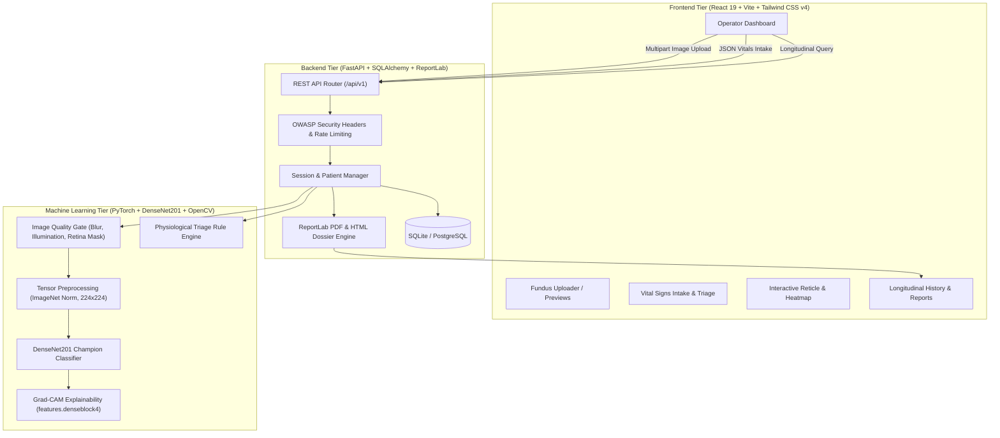

# Multimodal Health Screening & Analysis System

An integrated clinical decision-support platform combining retinal fundus computer vision (`DenseNet201` + `Grad-CAM`) with physiological vital signs screening and longitudinal patient history tracking.

> [!IMPORTANT]
> **Clinical Decision-Support Disclaimer**  
> This system is strictly an investigational screening and clinical decision-support tool. It is **not** an autonomous diagnostic medical device. All model predictions, risk indicators, and heatmaps represent statistical likelihoods and must never supersede evaluation and formal diagnosis by certified ophthalmologists and licensed medical practitioners.

---

## 1. System Architecture

The application is structured into three integrated tiers with decoupled contracts:



---

## 2. Repository Directory Structure

```
multimodal-health-screening/
├── backend/                        # FastAPI ASGI Application & Persistence
│   ├── config.py                   # Environment settings, CORS, storage guardrails
│   ├── database.py                 # SQLAlchemy engine and session factory
│   ├── main.py                     # App lifespan, route registration, static mounts
│   ├── models_db.py                # Patient and ScreeningSession ORM models
│   ├── observability.py           # Structured JSON logging and request tracing
│   ├── schemas.py                  # Pydantic input/output validation contracts
│   ├── security.py                 # File validation, rate limiting, path sanitization
│   ├── utils.py                    # ReportLab PDF generator & HTML dossier builder
│   ├── .env.example                # Backend environment variable template
│   └── uploads/                    # Generated heatmaps and temporary uploads
│       └── gradcam/                # Grad-CAM PNG artifacts (gitignored)
├── frontend/                       # React 19 Client Application (Vite SPA)
│   ├── public/samples/             # Bundled sample retinal images for demo testing
│   ├── src/
│   │   ├── api.js                  # Axios client, backend URL resolver, demo mocks
│   │   ├── App.jsx                 # Top-level routing and patient state provider
│   │   ├── components/             # Reusable UI components
│   │   │   ├── EyeAssessment.jsx   # Heatmap overlay, probabilities chart, reticle
│   │   │   ├── ImageUpload.jsx     # Drag-and-drop file uploader & presets
│   │   │   ├── ManualVitals.jsx    # Manual vital signs input modal
│   │   │   ├── MedicalIcons.jsx    # Accessible SVG medical iconography
│   │   │   ├── Navbar.jsx          # Responsive navigation & patient selector
│   │   │   ├── PatientForm.jsx     # Patient registration modal
│   │   │   ├── PatientHistory.jsx  # Longitudinal timeline & biometric trends
│   │   │   ├── ReportDownload.jsx  # Clinical dossier modal with PDF export
│   │   │   └── VitalsPanel.jsx     # Biometric gauges & triage status badges
│   │   └── pages/                  # Route views
│   │       ├── CustomDomainGuide.jsx # Production DNS & SSL configuration
│   │       ├── PatientsPage.jsx    # Patient directory and search
│   │       ├── PrivacyPolicy.jsx   # HIPAA/GDPR health information policy
│   │       ├── ScreeningDashboard.jsx # Primary multimodal operator dashboard
│   │       └── TermsAndConditions.jsx # Clinical terms & liability disclaimers
│   ├── package.json                # Frontend dependencies and build scripts
│   ├── vite.config.js              # Vite build, proxy, and Tailwind configuration
│   └── e2e_production_smoke.cjs    # Headless Chrome browser smoke suite (Puppeteer)
├── ml/                             # Machine Learning & Retinal Deep Learning
│   ├── eye_model.py                # DenseNet201 architecture & safe PyTorch loader
│   ├── gradcam.py                  # Class activation mapping backpropagated from denseblock4
│   ├── physio_model.py             # Rule-based physiological vitals triage engine
│   ├── preprocessing.py            # ImageNet normalization and OpenCV tensor pipeline
│   ├── quality_gate.py             # Laplacian blur, illumination, and retinal mask validator
│   ├── screening_pipeline.py       # Unified end-to-end multimodal screening coordinator
│   ├── weights/
│   │   ├── eye_model.pth           # Champion PyTorch weights (70.34 MB, tracked)
│   │   └── checkpoint_selection.json # Selection metadata & promotion audit trail
│   └── tests/                      # Unit, integration, and property test suites (575 tests)
├── reports/                        # Visual test evidence & browser screenshots
├── tests/                          # System integration & production smoke test suites
│   ├── test_backend_advanced.py    # Error recovery, 503 fallback, concurrency
│   ├── test_backend_api.py         # Full API route contracts and matrix testing
│   ├── test_end_to_end_scenarios.py# Multithreaded safety and modality invariance
│   ├── test_frontend_integration.py# Static asset mounting and CORS validation
│   ├── test_observability_regression.py # Log structures, request IDs, error redaction
│   ├── test_production_api_smoke.py# Live 26-test HTTP smoke test suite
│   └── test_security_hardening.py  # Path traversal, magic bytes, decompression bombs
├── .env.example                    # Root environment configuration template
├── .gitignore                      # Git exclusion rules for secrets, DBs, caches
├── Dockerfile                      # Production multi-stage Docker container specification
├── docker-compose.yml              # Local container stack orchestration
├── pyproject.toml                  # Python package configuration and pytest settings
├── render.yaml                     # Render Infrastructure-as-Code deployment blueprint
├── requirements.txt                # Unified production Python dependencies
└── requirements-dev.txt            # Development and test runner dependencies
```

---

## 3. Supported Screening Workflows

1. **Workflow A: Retinal Fundus Screening (`POST /api/v1/predict_eye`)**
   - Ingests fundus photography (`.jpg`, `.jpeg`, `.png` up to 30 MB).
   - Validates image quality through Laplacian variance blur detection ($\ge 100.0$), brightness, contrast, and retinal circular mask boundaries.
   - Computes 4-class softmax probability distribution via `DenseNet201`.
   - Generates visual explainability heatmaps using Grad-CAM backpropagation from `features.denseblock4` overlaid with an OpenCV JET colormap.

2. **Workflow B: Physiological Vitals Screening (`POST /api/v1/submit_vitals`)**
   - Ingests numeric vital signs: Heart Rate (BPM), Blood Oxygen Saturation ($\text{SpO}_2$ %), and Body Temperature (°C).
   - Validates physiological bounds and rejects invalid types, booleans, NaN, and infinities.
   - Flags abnormalities (tachycardia, bradycardia, hypoxia, hypothermia, fever) and categorizes overall status (`Normal` vs. `Abnormal`).

3. **Workflow C: Combined Multimodal Screening (`POST /api/v1/screen`)**
   - Executes image assessment and vitals evaluation in a unified pipeline.
   - Synthesizes findings into an overall composite risk classification: `LOW`, `MODERATE`, `HIGH`, or `CRITICAL`.
   - Persists all observations, raw measurements, probabilities, and heatmap references to the patient's active screening encounter.

4. **Workflow D: Patient Intake & Longitudinal History (`/api/v1/patients`, `/api/v1/sessions`)**
   - Registers patients with demographics, identifiers, and clinical notes.
   - Tracks longitudinal encounters across visits with historical biomarker trend charts.

5. **Workflow E: Clinical Dossier Export (`GET /api/v1/sessions/{session_id}/report`)**
   - Generates formal, printable clinical dossiers in PDF format via ReportLab (`format=pdf`).
   - Serves structured browser dossier views (`format=html`).

---

## 4. Canonical Model Checkpoint & Disease Classes

The model checkpoint is located at:
`ml/weights/eye_model.pth` (70.34 MB | SHA-256: `e819440c35f166c90e6469b071cc83136857e95aa80bcd6697336894bb459f5f`)

The classification head enforces the strict canonical class ordering:
```python
CLASS_NAMES = [
    "cataract",              # Index 0
    "diabetic_retinopathy",  # Index 1
    "glaucoma",              # Index 2
    "normal"                 # Index 3
]
```

- **Architecture:** Torchvision `DenseNet201` with custom 4-class linear classifier head.
- **Hardware Acceleration:** Automatic hardware selection (`cuda` if available with ~39ms latency; graceful fallback to `cpu` with ~450ms latency).

---

## 5. Prerequisites & Environment Compatibility

| Component | Minimum Version | Verified Runtime | Notes |
| :--- | :--- | :--- | :--- |
| **Python** | `>= 3.10` | `3.12.4 x86_64` | Windows, Linux, macOS |
| **Node.js** | `>= 18.0.0` | `v22.x` | Required for Vite frontend |
| **npm** | `>= 9.0.0` | `10.x` | Package manager for frontend |
| **PyTorch** | `>= 2.4.0` | `2.6.0+cu124` | CUDA 12.4 supported or CPU |
| **Google Chrome** | Latest stable | Version 131+ | Required for headless E2E smoke tests |

---

## 6. Installation & Local Setup

### Step 1: Clone the Repository
```bash
git clone https://github.com/AryanSharma221/Eye-ML-Model.git
cd Eye-ML-Model
```

### Step 2: Set Up Backend Virtual Environment
```powershell
# Windows PowerShell
python -m venv venv
.\venv\Scripts\Activate.ps1
pip install -r requirements.txt
```

```bash
# Linux / macOS
python3 -m venv venv
source venv/bin/activate
pip install -r requirements.txt
```

> [!NOTE]
> For GPU acceleration on Windows/Linux with NVIDIA CUDA 12.4:
> `pip install torch torchvision --index-url https://download.pytorch.org/whl/cu124`

### Step 3: Install Frontend Dependencies
```bash
cd frontend
npm install
cd ..
```

### Step 4: Configure Environment Variables
Copy the provided `.env.example` to `.env`:
```bash
cp .env.example .env
```

Key environment options:
```ini
HOST=0.0.0.0
PORT=8000
DATABASE_URL=sqlite:///./backend/health_screening.db
CORS_ORIGINS=http://localhost:5173,http://127.0.0.1:5173
CHECKPOINT_PATH=ml/weights/eye_model.pth
ML_DEVICE=auto
UPLOADS_DIR=backend/uploads
MAX_UPLOAD_SIZE_MB=30
RATE_LIMIT_PER_MINUTE=60
```

---

## 7. Running the Application Locally

### Running the Backend Server
```powershell
# From project root with venv activated
uvicorn backend.main:app --host 0.0.0.0 --port 8000 --reload
```
- API Documentation (Swagger UI): [http://localhost:8000/docs](http://localhost:8000/docs)
- OpenAPI JSON Spec: [http://localhost:8000/openapi.json](http://localhost:8000/openapi.json)
- Liveness Probe: [http://localhost:8000/health/live](http://localhost:8000/health/live)
- Readiness Probe: [http://localhost:8000/health/ready](http://localhost:8000/health/ready)

### Running the Frontend Development Server
```bash
cd frontend
npm run dev
```
- Client Application: [http://localhost:5173](http://localhost:5173)

---

## 8. API Endpoint Reference

| Method | Endpoint | Description | Request Type | Status Codes |
| :--- | :--- | :--- | :--- | :--- |
| `GET` | `/health/live` | Container liveness check | None | `200` |
| `GET` | `/health/ready` | Readiness check (validates model weights & DB) | None | `200`, `503` |
| `POST` | `/api/v1/predict_eye` | Retinal fundus disease classification & Grad-CAM | `multipart/form-data` | `200`, `400`, `413`, `500` |
| `POST` | `/api/v1/submit_vitals` | Physiological vital signs triage evaluation | `application/json` | `200`, `400`, `422` |
| `POST` | `/api/v1/screen` | Multimodal combined screening (Image + Vitals) | `multipart/form-data` | `200`, `400`, `413`, `500` |
| `GET` | `/api/v1/patients` | List registered patients | None | `200` |
| `POST` | `/api/v1/patients` | Register a new patient record | `application/json` | `201`, `400` |
| `GET` | `/api/v1/patients/{id}` | Retrieve patient record by ID | None | `200`, `404` |
| `GET` | `/api/v1/sessions` | List recent screening encounters | None | `200` |
| `POST` | `/api/v1/sessions` | Initialize a new screening session | `application/json` | `201`, `404` |
| `GET` | `/api/v1/sessions/{id}` | Retrieve session details, eye & vitals records | None | `200`, `404` |
| `GET` | `/api/v1/sessions/{id}/report`| Export clinical dossier (`format=pdf` or `html`) | Query Param | `200`, `400`, `404` |

---

## 9. Verification & Automated Testing Suites

### 1. Backend Regression Suite (63 Tests)
Validates error boundary contracts, OWASP security headers, path traversal protection, decompression bomb guards, database persistence, and ReportLab PDF rendering:
```powershell
python -m pytest tests/
```
*Result: 63 / 63 passed (100%).*

### 2. Live Production API Smoke Test (26 Tests)
Executes real HTTP network requests against the running FastAPI service, testing all four disease classes, triage rules, input rejections, and PDF generation:
```powershell
python tests/test_production_api_smoke.py
```
*Result: 26 / 26 passed (100%). Report generated at `tests/production_api_smoke_report.json`.*

### 3. Headless Chrome Browser E2E Smoke Test (26 Tests)
Spawns headless Chromium via Puppeteer to test client routes, 4 responsive viewports, real inference execution, UI condition rendering, and console hygiene:
```powershell
node frontend/e2e_production_smoke.cjs
```
*Result: 26 / 26 passed (100%), 0 console errors, 0 network failures. Screenshot saved to `reports/part12_production_browser_smoke.png`.*

### 4. ML Core & Checkpoint Verification (53 Tests)
Exercises the deep learning pipeline, safe weight loading, class order invariance, and Grad-CAM hooks:
```powershell
pytest ml/tests/test_inference_smoke.py ml/tests/test_screening_workflow.py ml/tests/test_checkpoint_manager.py
```
*Result: 53 / 53 passed (100%).*

### 5. Frontend Quality Checks
```bash
cd frontend
npm run lint      # oxlint: 0 warnings, 0 errors
npm run build     # Vite production build: dist/ (181 kB gzip)
```

---

## 10. Containerization & Deployment

### Production Docker Container
A multi-stage Docker build is provided in `Dockerfile`:
```bash
# Build unified container
docker build -t health-screening:latest .

# Run container on port 8000
docker run -p 8000:8000 -e ML_DEVICE=cpu health-screening:latest
```

### Cloud Platform Deployment Guides

#### Backend (Render / Railway / AWS ECS)
1. Connect the GitHub repository `AryanSharma221/Eye-ML-Model`.
2. Configure **Environment**: Python 3.11/3.12.
3. Set **Build Command**: `pip install -r requirements.txt`.
4. Set **Start Command**: `uvicorn backend.main:app --host 0.0.0.0 --port $PORT`.
5. Environment Variables:
   - `ML_DEVICE=cpu`
   - `CHECKPOINT_PATH=ml/weights/eye_model.pth`
   - `CORS_ORIGINS=https://<your-frontend-domain>.vercel.app`

#### Frontend (Vercel / Netlify / Cloudflare Pages)
1. Connect repository root with directory `frontend`.
2. Framework preset: **Vite**.
3. Build command: `npm run build`. Output directory: `dist`.
4. Environment Variables:
   - `VITE_API_BASE_URL=https://<your-backend-domain>.onrender.com/api/v1`

---

## 11. Troubleshooting & Known Limitations

- **Model Weight Location:** If the backend reports `503 Service Unavailable`, verify that `ml/weights/eye_model.pth` exists. The service will refuse readiness if the checkpoint is absent or tampered with.
- **CORS Blocked in Browser:** If the frontend displays `Network Error` or fails to fetch, ensure the frontend origin is listed in the backend's `CORS_ORIGINS` environment variable.
- **Port Conflicts:** If port 8000 or 5173 is already occupied, set `PORT=8080` in `.env` for the backend or run `npm run dev -- --port 3000` for the frontend.
- **Memory Footprint:** Running PyTorch on memory-constrained containers (< 512 MB) may cause out-of-memory kill signals during model initialization. A minimum of 1 GB RAM (or 2 GB recommended) is advised for CPU forward passes.
- **Raw Training Dataset:** The repository contains the trained model weights and evaluation manifests, but the original 5,889-image Kaggle dataset is excluded from Git to prevent repository bloat. To retrain from scratch, download the dataset and place it under `ml/dataset/`.
