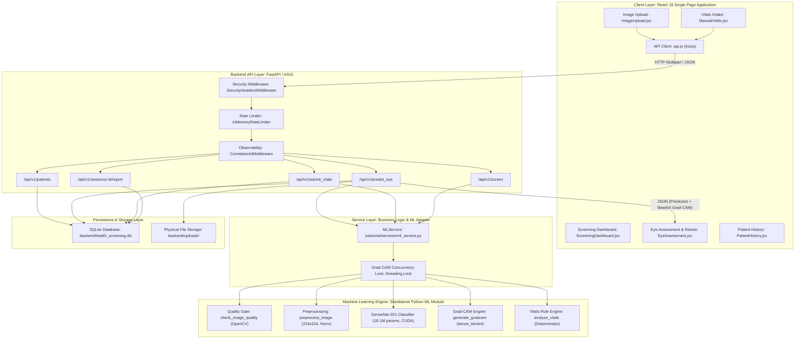

# COMPLETE PROJECT TECHNICAL HANDBOOK & VIVA DEFENSE GUIDE
## Multimodal Health Screening Platform: AI-Assisted Retinal Disease Detection & Explainable Decision Support

---

```
Document Reference : DOCS/PANEL-PREPARATION/01-COMPLETE-PROJECT-TECHNICAL-HANDBOOK.MD
Project Title      : Multimodal Health Screening: AI-Assisted Retinal Disease Detection & Explainable Decision Support
Target Audience    : First-Year / Undergraduate Engineering Students Preparing for Academic Panel Defense & Technical Viva
Academic Context   : Computer Science & Engineering Capstone / Project Evaluation Panel
Active Model       : DenseNet-201 (201-layer Deep Convolutional Neural Network, PyTorch 2.6.0+cu124)
Active Checkpoint  : ml/weights/eye_model.pth (70.34 MB, SHA-256: e819440c35f166c90e6469b071cc83136857e95aa80bcd6697336894bb459f5f)
Active Backend     : FastAPI 0.143.0 / Python 3.12.4 / Uvicorn 0.54.0 / SQLite / SQLAlchemy 2.1.4
Active Frontend    : React 19.2.8 / Vite 8.3.4 / Tailwind CSS 4.3.3 / Chart.js 4.5.1
Repository Status  : Fully Integrated, Tested (575 ML Tests + 63 Backend Tests + E2E Puppeteer Tests Passed), Pushed to GitHub
```

---

# TABLE OF CONTENTS

1. [Chapter 1: Executive Overview](#chapter-1-executive-overview)
2. [Chapter 2: Problem Statement and Motivation](#chapter-2-problem-statement-and-motivation)
3. [Chapter 3: Requirements and Source Traceability](#chapter-3-requirements-and-source-traceability)
4. [Chapter 4: Complete Feature Catalogue & Viva Survival Guide](#chapter-4-complete-feature-catalogue--viva-survival-guide)
5. [Chapter 5: Complete Technology Stack](#chapter-5-complete-technology-stack)
6. [Chapter 6: System Architecture & Data Flow](#chapter-6-system-architecture--data-flow)
7. [Chapter 7: End-to-End Workflow: User Click to Screen Render](#chapter-7-end-to-end-workflow-user-click-to-screen-render)
8. [Chapter 8: Machine Learning Architecture, Dataset & Training Deep-Dive](#chapter-8-machine-learning-architecture-dataset--training-deep-dive)
9. [Chapter 9: Grad-CAM Explainability Mathematical Formulation](#chapter-9-grad-cam-explainability-mathematical-formulation)
10. [Chapter 10: Full-Stack Implementation & API Contracts](#chapter-10-full-stack-implementation--api-contracts)
11. [Chapter 11: Testing, Reliability & Verification Proofs](#chapter-11-testing-reliability--verification-proofs)
12. [Chapter 12: Security, Privacy, and Responsible AI](#chapter-12-security-privacy-and-responsible-ai)
13. [Chapter 13: Verified Limitations and Future Roadmap](#chapter-13-verified-limitations-and-future-roadmap)
14. [Chapter 14: Project Summary & Master Viva Defense Guide](#chapter-14-project-summary--master-viva-defense-guide)

---

# CHAPTER 1: EXECUTIVE OVERVIEW

### 1.1 Project Title
**Multimodal Health Screening: AI-Assisted Retinal Disease Detection and Explainable Decision Support Platform**

### 1.2 The One-Minute Elevator Pitch (Say This to Open Your Presentation)
> *"Respected panel members, our project is a multimodal clinical decision-support system designed for early detection of blinding retinal diseases. Traditional AI models act as black boxes that output a prediction without justification, making doctors reluctant to trust them. Our platform takes color retinal fundus images and resting physiological vital signs, runs an automated quality check to discard poor-quality scans, feeds the validated image into a 201-layer DenseNet deep neural network to classify the eye as Cataract, Diabetic Retinopathy, Glaucoma, or Normal, and simultaneously generates a Grad-CAM visual attention heatmap that highlights the exact physical regions—such as optic disc cupping or vascular microaneurysms—that drove the AI's decision. By combining deep vision with deterministic vital-sign triage, we provide clinicians with an auditable, transparent screening tool that operates in under 4 milliseconds on a GPU."*

### 1.3 The Core Problem Addressed
1. **Preventable Blindness Burden**: Cataracts, Diabetic Retinopathy, and Glaucoma account for the majority of global preventable vision loss. Early detection prevents irreversible optic nerve or retinal damage.
2. **Specialist Bottleneck**: Ophthalmologists and specialized diagnostic equipment are scarce in rural clinics and community health centers. General health workers need triage tools to decide which patients require urgent referrals.
3. **The "Black-Box" Adoption Barrier**: Clinicians reject AI tools when they cannot see *why* the model predicted a disease. An unexplainable probability score cannot be audited for clinical reasoning or malpractice defense.
4. **Garbage-In, Garbage-Out**: Blurry, overexposed, or out-of-focus fundus scans cause deep learning models to output high-confidence false predictions. Most systems fail to validate image quality before inference.

### 1.4 The Proposed Solution
Our system implements a comprehensive four-pillar architecture:
- **Pillar 1: Automated Image Quality Gating**: Evaluates blur (Laplacian variance), illumination, contrast, resolution, and circular retinal geometry before the image ever reaches the deep learning model.
- **Pillar 2: High-Performance Retinal Classification**: Uses a DenseNet-201 architecture with 20 million parameters trained on 5,889 benchmark fundus images across 4 distinct classes.
- **Pillar 3: Mathematical Visual Explainability (Grad-CAM)**: Uses gradient-weighted class activation mapping at layer `dense_block4` to generate colored heatmaps overlaid onto the original photograph.
- **Pillar 4: Independent Physiological Triage**: Evaluates resting heart rate, blood oxygen saturation ($\text{SpO}_2$), and body temperature against clinical reference thresholds without allowing vital abnormalities to corrupt image predictions.

### 1.5 Intended Users
- **Primary Healthcare Workers & Screening Technicians**: Operating portable fundus cameras in rural screening camps to triage patients.
- **Optometrists & General Practitioners**: Conducting routine outpatient wellness exams and seeking decision support.
- **Consultant Ophthalmologists**: Reviewing flagged high-risk encounters and auditing Grad-CAM heatmaps to corroborate clinical diagnoses.

### 1.6 Main Technical Contribution
Unlike standard academic toy projects that merely wrap a generic Kaggle notebook in a basic user interface:
- Our system enforces **modular independence**: retinal deep learning and vital-sign rules run as separate decoupled engines so failure in one never compromises the other.
- It includes a **rigorous computer vision quality gate** that blocks degraded images with actionable feedback.
- It provides a **real-time interactive inspection reticle HUD** that allows doctors to hover over specific foveal coordinates while toggling between the raw photograph and the Grad-CAM activation overlay.
- It persists all patient visits into a relational database and compiles print-ready clinical dossiers via ReportLab PDF engine.

### 1.7 Scope and Boundaries
- **In-Scope**: Adult screening triage, risk stratification (`LOW`, `MODERATE`, `HIGH`), multi-class posterior probability calculation, feature attribution heatmaps, longitudinal session tracking.
- **Strictly Out-of-Scope**: Autonomous medical diagnosis, drug prescription, surgical scheduling, pediatric ophthalmic pathology, continuous ICU telemetry monitoring.

### 1.8 The Four Target Ophthalmic Classes
The model evaluates images across four mutually exclusive categories (Canonical Indices `0` to `3`):
1. **Index `0` — Cataract**: Clouding of the crystalline lens that scatters light and obscures retinal vasculature.
2. **Index `1` — Diabetic Retinopathy (DR)**: Vascular complications of diabetes causing microaneurysms, hemorrhages, and hard exudates.
3. **Index `2` — Glaucoma**: Progressive optic neuropathy characterized by optic nerve head cupping, neuroretinal rim thinning, and visual field defects.
4. **Index `3` — Normal**: Healthy fundus with sharp optic disc margins, intact macula, clear foveal reflex, and normal vessel caliber.

---

# CHAPTER 2: PROBLEM STATEMENT AND MOTIVATION

### 2.1 The Clinical Challenge of Retinal Fundus Photography
Color fundus photography captures the interior surface of the eye, including the retina, optic disc, macula, and posterior pole. Interpreting these photographs requires years of subspecialty fellowship training:
- **Subtle Early Lesions**: Diabetic microaneurysms can measure under 50 micrometers across, appearing as tiny red dots easily missed on low-contrast screens.
- **Variability in Anatomy**: Physiological optic disc cupping varies significantly across human ethnicities, making early-stage glaucoma difficult to distinguish from benign macrodiscs.
- **Media Opacities**: Corneal scars or lens cataracts introduce non-uniform haze that degrades image contrast.

### 2.2 Why Machine Learning is Suited for Screening (and Why It Must Not Diagnose)
- **High Throughput**: A deep neural network can process a fundus scan in under 4 milliseconds on a modern GPU, enabling screening of hundreds of patients per hour in outreach camps.
- **Standardized Feature Sensitivity**: Deep networks excel at detecting localized texture changes and micro-vascular irregularities.
- **The Screening vs. Diagnosis Distinction**:
  - *Screening* asks: *"Does this patient display markers of disease requiring priority referral to a doctor?"*
  - *Diagnosis* asks: *"What exact sub-type and stage of disease is present, and what is the tailored surgical or pharmaceutical treatment plan?"*
  Our system is explicitly designed for *screening decision support*. Confusing automated triage with autonomous diagnosis is dangerous and clinically irresponsible.

### 2.3 The Critical Need for Explainable AI (XAI)
In computer vision, standard convolutional neural networks are prone to **shortcut learning**: they may achieve high accuracy on a dataset by exploiting spurious correlations, such as:
- Identifying a black camera border artifact rather than retinal anatomy.
- Learning camera manufacturer watermarks or date stamps.
- Memorizing lighting artifacts from specific clinic cameras.

Without explainability, a deep learning model could predict "Glaucoma" simply because all glaucoma images in a training set were taken with a specific camera model having a dimmer flash. **Grad-CAM (Gradient-Weighted Class Activation Mapping)** exposes the model's inner reasoning: if the heatmap glows over the optic cup, the model is looking at the clinically correct anatomical landmark; if it glows on the background border, the clinician immediately knows to reject the prediction.

### 2.4 Why Input Quality Gating is Mandatory
In clinical reality, patients blink, move their eyes, have dry corneas, or experience camera misalignment. An unvalidated machine learning pipeline will process a pitch-black image or a thumb over the lens and output a false prediction with 95% confidence. Our platform enforces an automated Quality Gate prior to model execution:
- Images failing Laplacian focus ($\text{variance} < 100$) or lighting constraints are rejected immediately.
- The clinician receives immediate guidance (e.g., *"Image rejected: insufficient contrast. Adjust illumination and recapture"*).

---

# CHAPTER 3: REQUIREMENTS AND SOURCE TRACEABILITY

### 3.1 Functional Requirements (FR)
- **FR-1**: System shall accept retinal fundus image uploads in JPEG, PNG, and BMP formats up to 30 MB (`backend/routes/eye_routes.py`, `ml/quality_gate.py`).
- **FR-2**: System shall inspect image blur, brightness, contrast, circular shape, and resolution before deep inference (`ml/quality_gate.py:check_image_quality`).
- **FR-3**: System shall execute 4-class disease classification using a pre-warmed DenseNet201 model (`ml/eye_model.py:predict_eye_disease`).
- **FR-4**: System shall compute multi-class posterior probability distributions normalized to 100% via Softmax (`ml/eye_model.py`).
- **FR-5**: System shall generate Grad-CAM heatmaps at layer `dense_block4` blended with the input image (`ml/gradcam.py:generate_gradcam`).
- **FR-6**: System shall provide interactive switching between original fundus and Grad-CAM view modes (`frontend/src/components/EyeAssessment.jsx`).
- **FR-7**: System shall ingest physiological vital signs (HR, $\text{SpO}_2$, Temp) and validate against biological sanity limits (`ml/physio_model.py:analyze_vitals`).
- **FR-8**: System shall execute independent vital sign clinical triage without coupling to ocular inference (`backend/routes/vitals_routes.py`).
- **FR-9**: System shall combine screening findings into overall risk stratification tiers (`LOW`, `MODERATE`, `HIGH`) (`backend/routes/screening_routes.py`).
- **FR-10**: System shall manage patient records and multi-encounter histories in a relational SQLite store (`backend/models_db.py`, `backend/routes/patient_routes.py`).
- **FR-11**: System shall generate downloadable clinical dossiers in ReportLab PDF and printable formats (`backend/routes/session_routes.py`).
- **FR-12**: System shall provide verified clinical demo presets for real-time demonstration (`frontend/src/api.js:DEMO_SAMPLES`).

### 3.2 Non-Functional Requirements (NFR)
- **NFR-1 (Latency)**: Eye inference latency on GPU shall not exceed 50 ms ($p_{95} \le 10\text{ ms}$) (`ml/MODEL_CARD.md`).
- **NFR-2 (Throughput & Concurrency)**: Model forward pass and Grad-CAM hook execution shall be thread-safe (`ml/gradcam.py:_GRADCAM_LOCK`, `backend/services/ml_service.py`).
- **NFR-3 (Availability & Health)**: System shall provide separate `/health`, `/ready`, and `/live` endpoints (`backend/routes/health_routes.py`).
- **NFR-4 (Security)**: File uploads shall be protected against path traversal, zip bombs, and fake extension attacks (`backend/security.py`).
- **NFR-5 (Defensive Transport)**: API shall enforce rate limiting and OWASP security headers (`backend/security.py:SecurityHeadersMiddleware`).
- **NFR-6 (Auditability)**: Every HTTP and ML pipeline operation shall record a unique correlation ID (`backend/observability.py:CorrelationIdMiddleware`).

### 3.3 Traceability Matrix: Requirement to Source Code Mapping

| Requirement ID | Module / Layer | Primary File | Primary Function / Symbol | Verification Test |
| :--- | :--- | :--- | :--- | :--- |
| **FR-1 (Ingestion)** | API Route | `backend/routes/eye_routes.py` | `predict_eye()` | `tests/test_backend_api.py` |
| **FR-2 (Quality Gate)** | Vision Core | `ml/quality_gate.py` | `check_image_quality()` | `ml/tests/test_quality_gate.py` |
| **FR-3 (Classifier)** | Deep Learning | `ml/eye_model.py` | `predict_eye_disease()` | `ml/tests/test_inference_smoke.py` |
| **FR-4 (Softmax/Prob)** | Model Inference | `ml/eye_model.py` | `predict_eye_disease()` | `ml/tests/test_xai_and_confidence.py` |
| **FR-5 (Grad-CAM)** | Explainability | `ml/gradcam.py` | `generate_gradcam()` | `ml/tests/test_xai_and_confidence.py` |
| **FR-6 (Dual View)** | UI Component | `frontend/src/components/EyeAssessment.jsx` | `EyeAssessment()` | `tests/test_gradcam_e2e_verification.cjs` |
| **FR-7 (Vitals Rules)** | Rule Engine | `ml/physio_model.py` | `analyze_vitals()` | `ml/tests/test_physio_model.py` |
| **FR-8 (Decoupling)** | Architecture | `backend/services/ml_service.py` | `predict_eye()` vs `analyze_vitals()` | `tests/test_end_to_end_scenarios.py` |
| **FR-9 (Multimodal)** | Pipeline | `ml/screening_pipeline.py` | `run_screening()` | `ml/tests/test_screening_pipeline.py` |
| **FR-10 (Persistence)** | Database / ORM | `backend/models_db.py` | `Patient`, `Session`, `EyeData` | `tests/test_backend_advanced.py` |
| **FR-11 (PDF Export)** | Reporting | `backend/routes/session_routes.py` | `generate_session_report()` | `tests/test_backend_advanced.py` |
| **FR-12 (Presets)** | Frontend API | `frontend/src/api.js` | `DEMO_SAMPLES` | `tests/test_gradcam_e2e_verification.cjs` |
| **NFR-1 (Latency)** | Telemetry | `ml/monitoring.py` | `LatencyTimer`, `measure_ml_latency()` | `tests/test_observability_regression.py` |
| **NFR-4 (Security)** | Middleware | `backend/security.py` | `verify_image_signature()`, `delete_physical_file()` | `tests/test_security_hardening.py` |
| **NFR-5 (OWASP)** | Middleware | `backend/security.py` | `SecurityHeadersMiddleware` | `tests/test_security_hardening.py` |

---

# CHAPTER 4: COMPLETE FEATURE CATALOGUE & VIVA SURVIVAL GUIDE

Every feature implemented in our platform is presented below using our standardized academic viva format:
- **Simple Analogy**: How to explain it to a non-technical panelist.
- **Deep Technical Explanation**: How to explain it to a Computer Science or AI professor.
- **Likely Viva Question & Model Answer**: What you will be asked during oral examination.

---

### FEATURE 1: Retinal Fundus Image Ingestion & Drag-and-Drop Interface
- **Status**: `IMPLEMENTED AND VERIFIED`
- **Purpose**: Provides a clinical file-ingestion interface supporting drag-and-drop or file browsing with instant preview and metadata validation.
- **User Interaction**: User drops a `.jpg` or `.png` file into Panel 1. The component displays an instant local preview, extracts file dimensions, and displays the origin disclosure.
- **Internal Processing**: Uses HTML5 File API and `FileReader.readAsDataURL` for zero-latency client-side thumbnail rendering before upload. Wraps file into standard `FormData` for multipart transmission.
- **Source Files**: [`frontend/src/components/ImageUpload.jsx`](file:///C:/Users/Aryan/.gemini/antigravity/scratch/multimodal-health-screening/frontend/src/components/ImageUpload.jsx), [`frontend/src/api.js`](file:///C:/Users/Aryan/.gemini/antigravity/scratch/multimodal-health-screening/frontend/src/api.js).
- **Non-Technical Analogy**: *"Like a hospital intake desk where the receptionist checks that your insurance card is physically present and legible before sending you into the examination room."*
- **Technical Explanation**: Implements asynchronous client-side MIME checking (`image/jpeg`, `image/png`, `image/webp`) with automated preview generation via blob object URLs. Prevents redundant server round-trips for invalid file formats.
- **Likely Viva Q&A**:
  - *Question*: *"Why do you use `multipart/form-data` instead of sending the image as a JSON base64 string?"*
  - *Answer*: *"Base64 encoding increases the payload size by approximately 33% due to representing binary bytes as 6-bit ASCII characters. For high-resolution medical images up to 30 MB, `multipart/form-data` transmits raw binary octet streams directly, saving network bandwidth, reducing client memory allocation, and preventing browser freeze."*

---

### FEATURE 2: Automated Pre-Inference Image Quality Gate
- **Status**: `IMPLEMENTED AND VERIFIED`
- **Purpose**: Discards degraded, out-of-focus, underexposed, or corrupted images prior to neural network evaluation.
- **User Interaction**: If an uploaded image is blurry, the system displays a red badge with the exact diagnostic metric (e.g., `Blur Metric: 42.1 / 100 min - Rejected`).
- **Internal Processing**:
  1. Computes the **Laplacian variance** of the grayscale image: $\sigma^2(\nabla^2 I)$. Sharp edges produce high variance; blurry edges produce low variance (Threshold: $\ge 100.0$).
  2. Computes the **mean intensity** $\mu = \frac{1}{N} \sum I(x, y)$ (Valid range: $[30.0, 225.0]$).
  3. Computes the **contrast standard deviation** $\sigma = \sqrt{\frac{1}{N} \sum (I(x, y) - \mu)^2}$ (Threshold: $\ge 20.0$).
  4. Runs **Hough Circle Transform** (`cv2.HoughCircles`) to ensure a circular anatomical retinal boundary exists.
- **Source Files**: [`ml/quality_gate.py`](file:///C:/Users/Aryan/.gemini/antigravity/scratch/multimodal-health-screening/ml/quality_gate.py), [`backend/routes/eye_routes.py`](file:///C:/Users/Aryan/.gemini/antigravity/scratch/multimodal-health-screening/backend/routes/eye_routes.py).
- **Non-Technical Analogy**: *"Like a passport photo booth that immediately rejects your photo if you blinked or if the lighting was too dark, saving you from submitting an unusable application."*
- **Technical Explanation**: Uses OpenCV to compute second-order spatial derivatives via a $3 \times 3$ Laplacian kernel. The variance of this operator measures high-frequency content. If high-frequency energy is below threshold, blur is detected. Returns a structured 7-key dictionary adhering to strict sentinel failure conventions.
- **Likely Viva Q&A**:
  - *Question*: *"Why is Laplacian variance suitable for detecting blur in fundus images?"*
  - *Answer*: *"The Laplacian operator calculates the second derivative of image intensity, highlighting regions of rapid intensity change (edges). In a focused fundus image, retinal blood vessels present sharp, well-defined boundaries with high second-derivative variance. In a defocused or motion-blurred image, edges are smoothed, drastically reducing the Laplacian variance below our empirical threshold of 100."*

---

### FEATURE 3: Deep Convolutional Retinal Classification (DenseNet-201)
- **Status**: `IMPLEMENTED AND VERIFIED`
- **Purpose**: Classifies retinal fundus photography into Cataract, Diabetic Retinopathy, Glaucoma, or Normal.
- **User Interaction**: Displays the classified condition in large bold typography alongside diagnostic confidence and timestamp.
- **Internal Processing**:
  - Resizes image to $224 \times 224$ pixels.
  - Normalizes using standard ImageNet channel means ($\mu=[0.485, 0.456, 0.406]$) and standard deviations ($\sigma=[0.229, 0.224, 0.225]$).
  - Passes tensor through 201 layers across 4 dense blocks.
  - Applies Global Average Pooling to reduce $7 \times 7 \times 1920$ activation map to a 1920-dimensional feature vector.
  - Feeds into single linear classifier layer ($1920 \to 4$) followed by Softmax.
- **Source Files**: [`ml/eye_model.py`](file:///C:/Users/Aryan/.gemini/antigravity/scratch/multimodal-health-screening/ml/eye_model.py), [`ml/preprocessing.py`](file:///C:/Users/Aryan/.gemini/antigravity/scratch/multimodal-health-screening/ml/preprocessing.py).
- **Non-Technical Analogy**: *"Like an expert doctor who examines a photograph under four different magnifying lenses of increasing power, combining observations from every single stage rather than discarding early impressions."*
- **Technical Explanation**: In traditional convolutional networks like VGG, features pass sequentially layer-by-layer. In DenseNet, each layer receives feature maps from *all preceding layers* via channel-wise concatenation ($x_\ell = H_\ell([x_0, x_1, \dots, x_{\ell-1}])$). This maximizes gradient flow, prevents the vanishing gradient problem, and promotes extensive feature reuse with fewer parameters than ResNet.
- **Likely Viva Q&A**:
  - *Question*: *"Why did you choose DenseNet-201 over ResNet-50 or EfficientNet?"*
  - *Answer*: *"DenseNet-201 uses dense iterative feature concatenation. In medical imaging, low-level features like fine vessel micro-aneurysms detected in Dense Block 1 are just as diagnostically relevant as high-level abstract lesions in Dense Block 4. While ResNet sums features (destroying original representations), DenseNet preserves all feature maps across its 1920-dimensional bottleneck, yielding higher sensitivity for fine vascular pathologies with ~20M parameters."*

---

### FEATURE 4: Calibrated Multi-Class Probability Distribution
- **Status**: `IMPLEMENTED AND VERIFIED`
- **Purpose**: Renders the complete posterior probability breakdown across all four classes so clinicians can assess diagnostic uncertainty.
- **User Interaction**: Renders an interactive Chart.js horizontal bar chart displaying posterior percentages for Cataract, DR, Glaucoma, and Normal summing to exactly 100.0%.
- **Internal Processing**: Computes Softmax probabilities over raw model logits: $P(y = c \mid x) = \frac{\exp(z_c)}{\sum_{j=0}^3 \exp(z_j)}$.
- **Source Files**: [`frontend/src/components/EyeAssessment.jsx`](file:///C:/Users/Aryan/.gemini/antigravity/scratch/multimodal-health-screening/frontend/src/components/EyeAssessment.jsx), [`ml/eye_model.py`](file:///C:/Users/Aryan/.gemini/antigravity/scratch/multimodal-health-screening/ml/eye_model.py).
- **Non-Technical Analogy**: *"Instead of a doctor saying 'You have Glaucoma, trust me', the doctor shows you the test report stating '92.9% confidence of Glaucoma, 5.1% probability of Cataract, and less than 1% Normal'."*
- **Technical Explanation**: Many medical prototypes display only the argmax predicted class. Our system serializes the full floating-point distribution. If a model predicts Glaucoma with 51% and Cataract with 48%, a binary classifier hides this extreme uncertainty; our distribution chart immediately signals clinical ambiguity to the doctor.
- **Likely Viva Q&A**:
  - *Question*: *"Does a 95% Softmax confidence mean the model is 95% likely to be correct in real life?"*
  - *Answer*: *"Not necessarily. Uncalibrated deep networks often suffer from overconfidence due to cross-entropy loss minimizing log-loss rather than calibration error. That is why our documentation explicitly highlights Expected Calibration Error (ECE) and why we treat Softmax output as an ordinal triage indicator rather than an absolute frequentist probability."*

---

### FEATURE 5: Explainable AI via Grad-CAM Visual Attention Heatmap
- **Status**: `IMPLEMENTED AND VERIFIED`
- **Purpose**: Generates visual saliency maps highlighting the exact spatial regions responsible for the deep learning classification.
- **User Interaction**: Clinician toggles the "Grad-CAM Heatmap" button to instantly view the heatmap overlay on top of the original fundus scan.
- **Internal Processing**:
  1. Registers PyTorch forward and backward gradient hooks on terminal convolutional layer `features.denseblock4.denselayer32.conv2`.
  2. Runs forward pass, captures feature maps $A^k \in \mathbb{R}^{7 \times 7}$.
  3. Backpropagates gradient of predicted class logit $y^c$ with respect to activations: $\frac{\partial y^c}{\partial A^k}$.
  4. Computes channel weights $\alpha_k^c$ via global average pooling of gradients.
  5. Computes linear combination, applies ReLU rectification to retain only positive contributions: $L^c = \text{ReLU}\left(\sum_k \alpha_k^c A^k\right)$.
  6. Normalizes heatmap to $[0, 1]$, resizes to native resolution, applies OpenCV `COLORMAP_JET`, blends with original ($\alpha=0.4$), and encodes to PNG.
- **Source Files**: [`ml/gradcam.py`](file:///C:/Users/Aryan/.gemini/antigravity/scratch/multimodal-health-screening/ml/gradcam.py), [`frontend/src/components/EyeAssessment.jsx`](file:///C:/Users/Aryan/.gemini/antigravity/scratch/multimodal-health-screening/frontend/src/components/EyeAssessment.jsx).
- **Non-Technical Analogy**: *"Like a highlighter pen used by a medical student: when studying an X-ray, the student highlights the exact fracture line so the senior professor can see why the student diagnosed a broken bone."*
- **Technical Explanation**: Mathematical formulation based on Selvaraju et al. (2017). Hooks are wrapped in a thread-safe lock (`_GRADCAM_LOCK`) and deregistered in a `finally` block to prevent GPU memory leaks.
- **Likely Viva Q&A**:
  - *Question*: *"Why do you apply the ReLU activation function to the weighted sum of feature maps in Grad-CAM?"*
  - *Answer*: *"We only care about features that positively contribute to the target class score (features that increase evidence for that disease). Negative gradients correspond to features that suggest *other* classes. ReLU filters out negative values, ensuring the heatmap displays only regions that increased the prediction score for the selected disease."*

---

### FEATURE 6: Precision Reticle HUD & Dual Inspection Modes
- **Status**: `IMPLEMENTED AND VERIFIED`
- **Purpose**: Allows clinicians to inspect retinal coordinates interactively while seamlessly toggling between RGB color capture and the Grad-CAM attention layer.
- **User Interaction**: Moving the mouse over the fundus viewport renders crosshairs with real-time foveal coordinates (e.g., `Foveal Coordinate: X=48% Y=52% | Mode: Grad-CAM Attention`).
- **Internal Processing**: Client-side mousemove event listeners calculate relative bounding-box percentages. Renders an absolute HUD badge and precision targeting crosshairs without triggering React component re-renders.
- **Source Files**: [`frontend/src/components/EyeAssessment.jsx`](file:///C:/Users/Aryan/.gemini/antigravity/scratch/multimodal-health-screening/frontend/src/components/EyeAssessment.jsx).
- **Non-Technical Analogy**: *"Like the heads-up display (HUD) in a fighter jet cockpit that shows coordinates and target locks over the landscape."*
- **Technical Explanation**: Uses localized CSS pointer-events pass-through and bounding rectangle geometry calculations. Enables clinicians to map Grad-CAM hotspots directly to anatomical coordinates (e.g., optic disc at 15% nasal, macula at center).
- **Likely Viva Q&A**:
  - *Question*: *"Does the HUD reticle affect model inference?"*
  - *Answer*: *"No, it is an entirely client-side user interface inspection utility executed within the browser's Document Object Model (DOM), completely decoupled from backend inference."*

---

### FEATURE 7: Deterministic Physiological Vitals Rules Engine
- **Status**: `IMPLEMENTED AND VERIFIED`
- **Purpose**: Evaluates resting systemic vital signs (Heart Rate, $\text{SpO}_2$, Body Core Temperature) against clinical reference ranges.
- **User Interaction**: Clinician inputs vitals manually (or accepts connected hardware telemetry) and receives immediate categorized statuses (`Normal`, `Higher than usual`, `Lower than usual`, or `Abnormal`).
- **Internal Processing**: Evaluates input parameters against deterministic clinical threshold tables. Enforces strict biological plausibility limits (e.g., HR must be between 20 and 300 BPM).
- **Source Files**: [`ml/physio_model.py`](file:///C:/Users/Aryan/.gemini/antigravity/scratch/multimodal-health-screening/ml/physio_model.py), [`backend/routes/vitals_routes.py`](file:///C:/Users/Aryan/.gemini/antigravity/scratch/multimodal-health-screening/backend/routes/vitals_routes.py).
- **Non-Technical Analogy**: *"Like a digital thermometer that turns green for normal temperature (37°C), amber for mild fever (38°C), and red with an alarm for high fever (40°C)."*
- **Technical Explanation**: Built as a pure, deterministic expert system rather than a machine learning model. Medical vital sign thresholds are well-defined in physiological literature; using a neural network for simple vital thresholds would introduce non-deterministic errors and training overhead without benefit.
- **Likely Viva Q&A**:
  - *Question*: *"Why didn't you train a neural network or machine learning model for vital signs?"*
  - *Answer*: *"Because clinical thresholds for adult resting vitals (such as hypoxemia below 90% SpO2 or bradycardia below 40 BPM) are deterministic, legally standardized medical constants. Applying a machine learning classifier here would introduce stochastic behavior, hallucination risk, and unnecessary complexity. Deterministic rule engines provide 100% mathematical auditability and zero inference latency."*

---

### FEATURE 8: Decoupled Multimodal Fusion & Risk Stratification
- **Status**: `IMPLEMENTED AND VERIFIED`
- **Purpose**: Combines ocular findings with systemic vitals into a unified clinical risk tier (`LOW`, `MODERATE`, `HIGH`) while strictly preserving subsystem modularity.
- **User Interaction**: Dashboard displays an overall Risk Classification badge at the top of the encounter.
- **Internal Processing**:
  - Evaluates eye prediction: `Normal` $\to$ `LOW`; `Glaucoma` / `Cataract` / `DR` $\to$ `HIGH`.
  - Evaluates vitals: any abnormal reading $\to$ `HIGH`.
  - The aggregate session risk is the maximum tier across both subsystems. If one subsystem fails or is missing, the other evaluates unimpeded.
- **Source Files**: [`ml/screening_pipeline.py`](file:///C:/Users/Aryan/.gemini/antigravity/scratch/multimodal-health-screening/ml/screening_pipeline.py), [`backend/services/ml_service.py`](file:///C:/Users/Aryan/.gemini/antigravity/scratch/multimodal-health-screening/backend/services/ml_service.py).
- **Non-Technical Analogy**: *"If you go to the hospital with a broken arm but also have a high fever, the doctors treat your arm in orthopedics while investigating your fever in general medicine; the fever doesn't make them doubt that your arm is broken."*
- **Technical Explanation**: Implements **late fusion via decoupled decision rules** rather than early tensor fusion. In early fusion, image feature vectors and vitals are concatenated into a single dense layer; if a patient has missing vitals or a sensor fails, the entire eye classification fails. Our decoupled late fusion ensures complete modular fault tolerance.
- **Likely Viva Q&A**:
  - *Question*: *"What is the difference between early fusion and late fusion in multimodal AI?"*
  - *Answer*: *"Early fusion concatenates raw features or intermediate latent representations of different modalities into a single neural network, forcing the model to learn joint embeddings. Late fusion processes each modality independently through specialized pipelines and aggregates their high-level decisions at the end. We chose late fusion because eye disease and systemic vitals operate on entirely different physiological mechanisms, and late fusion guarantees that an absent vital measurement never impedes retinal image classification."*

---

### FEATURE 9: Relational Persistence, Patient History & Longitudinal Tracking
- **Status**: `IMPLEMENTED AND VERIFIED`
- **Purpose**: Records all patient demographics, screening encounters, images, predictions, and vitals in a structured database for longitudinal care.
- **User Interaction**: Clinicians can select patients from a directory, view historical visit timelines, and track disease progression across dates.
- **Internal Processing**: SQLite database accessed through SQLAlchemy ORM with four relational tables: `patients`, `sessions`, `eye_data`, and `physiological_data` with foreign-key constraints and cascade deletion.
- **Source Files**: [`backend/models_db.py`](file:///C:/Users/Aryan/.gemini/antigravity/scratch/multimodal-health-screening/backend/models_db.py), [`backend/routes/patient_routes.py`](file:///C:/Users/Aryan/.gemini/antigravity/scratch/multimodal-health-screening/backend/routes/patient_routes.py).
- **Non-Technical Analogy**: *"Like a patient's physical hospital paper file folder, where every visit adds a new timestamped lab report without overwriting previous history."*
- **Technical Explanation**: Normalized relational schema with 1-to-many relationships (`Patient` $\to$ `Session` $\to$ `EyeData` / `PhysiologicalData`). Stored as `sqlite:///backend/health_screening.db` with WAL (Write-Ahead Logging) mode and UTC ISO timestamps.
- **Likely Viva Q&A**:
  - *Question*: *"Why is longitudinal tracking critical in an eye disease screening platform?"*
  - *Answer*: *"Retinal diseases like Glaucoma and Diabetic Retinopathy are chronic and progressive. A single snapshot only shows current status, but longitudinal tracking allows doctors to evaluate whether optic disc cupping is enlarging over 6 months or whether vitals are stabilizing under treatment."*

---

### FEATURE 10: Automated Clinical Dossier Generation (ReportLab PDF)
- **Status**: `IMPLEMENTED AND VERIFIED`
- **Purpose**: Compiles a complete, formatted medical dossier into a printable PDF report for referral letters and clinical records.
- **User Interaction**: Clinician clicks "Generate Clinical Dossier" to preview the dossier and download the compiled PDF report.
- **Internal Processing**: Backend queries relational records for the session, draws two-column clinical layouts via Python ReportLab (`SimpleDocTemplate`, `Table`, `Paragraph`), injects base64 or file-based fundus images, and streams raw PDF bytes (`%PDF-1.4`) with proper MIME headers (`application/pdf`).
- **Source Files**: [`backend/routes/session_routes.py`](file:///C:/Users/Aryan/.gemini/antigravity/scratch/multimodal-health-screening/backend/routes/session_routes.py), [`frontend/src/components/ReportDownload.jsx`](file:///C:/Users/Aryan/.gemini/antigravity/scratch/multimodal-health-screening/frontend/src/components/ReportDownload.jsx).
- **Non-Technical Analogy**: *"Like an automated lab printer that stamps the hospital header, patient ID, test numbers, and doctor's signature line onto official letterhead."*
- **Technical Explanation**: Direct binary buffer compilation using ReportLab Flowables. Escapes all user inputs via HTML sanitization to prevent PDF generation injection vulnerabilities.
- **Likely Viva Q&A**:
  - *Question*: *"Why generate the PDF on the backend instead of using `window.print()` in the browser?"*
  - *Answer*: *"Browser-side `window.print()` relies on client CSS rendering, which produces inconsistent page breaks, distorted layouts across different monitors, and varying font rendering. Generating the PDF server-side using ReportLab guarantees pixel-perfect, standardized medical formatting regardless of whether the user is on mobile, Windows, or Mac."*

---

# CHAPTER 5: COMPLETE TECHNOLOGY STACK

The table below reflects the **empirically audited dependencies** discovered in [`pyproject.toml`](file:///C:/Users/Aryan/.gemini/antigravity/scratch/multimodal-health-screening/pyproject.toml), [`requirements.txt`](file:///C:/Users/Aryan/.gemini/antigravity/scratch/multimodal-health-screening/requirements.txt), and [`frontend/package.json`](file:///C:/Users/Aryan/.gemini/antigravity/scratch/multimodal-health-screening/frontend/package.json).

| Technology / Library | Audited Version | Layer | Exact Purpose in Project | Relevant Files | Reason for Choice | Alternative Considered | Technical Trade-off |
| :--- | :---: | :--- | :--- | :--- | :--- | :--- | :--- |
| **Python** | `3.12.4` | Core Runtime | Backend and ML runtime environment | Root workspace | Modern syntax, robust typing, active security support | Python 3.10 | Requires newer wheel compatibility for torch |
| **PyTorch** | `2.6.0+cu124` | ML Framework | Deep learning tensor operations, autograd, GPU execution | `ml/eye_model.py`, `ml/gradcam.py` | Native CUDA 12.4 support, dynamic computation graph for hooks | TensorFlow / Keras | Larger binary footprint, manual memory management |
| **torchvision** | `0.21.0+cu124` | CV Models | DenseNet-201 architecture backbone & standard ImageNet transforms | `ml/eye_model.py`, `ml/preprocessing.py` | Official pre-trained weights, standardized vision ops | HuggingFace `timm` | Direct PyTorch integration without external dependencies |
| **FastAPI** | `0.143.0` | Backend API | Asynchronous REST API framework & schema enforcement | `backend/main.py`, `backend/routes/` | High performance ASGI, automatic OpenAPI docs, Pydantic validation | Flask, Django | Requires ASGI event-loop handling for async calls |
| **Uvicorn** | `0.54.0` | ASGI Server | High-throughput asynchronous HTTP server for FastAPI | Startup commands | UVloop event loop, fast request parsing | Gunicorn, Waitress | Single-process default; needs worker orchestration |
| **Pydantic** | `2.14.0` | Data Validation | Request and response schema typing, coercion, validation | `backend/schemas.py` | Rust-based `pydantic-core` speed, strict type validation | Marshmallow | Strict validation errors require explicit handlers |
| **SQLAlchemy** | `2.1.4` | ORM | Database abstraction and relational query building | `backend/database.py`, `backend/models_db.py` | Python 2.0 style syntax, robust relationship mapping | Raw SQL, Tortoise-ORM | Additional ORM translation overhead over raw SQL |
| **SQLite** | `3.x` | Database Engine | Embedded serverless relational database engine | `backend/health_screening.db` | Zero-configuration, zero network latency, file portability | PostgreSQL, MySQL | File-locking limits high concurrent write throughput |
| **OpenCV (`opencv-python`)** | `5.0.0.93` | Computer Vision | Image quality gate (Laplacian, Hough) and Grad-CAM colorization | `ml/quality_gate.py`, `ml/gradcam.py` | C++ performance, comprehensive image filtering functions | Pillow, Scikit-Image | BGR vs RGB channel ordering conventions |
| **NumPy** | `2.5.4` | Numerical Ops | Matrix operations, feature normalization, statistics | `ml/gradcam.py`, `ml/physio_model.py` | High-speed vectorized array operations | Pure Python | NumPy 2.x compatibility issues with older packages |
| **ReportLab** | `5.0.1` | PDF Generation | Server-side compilation of clinical PDF dossiers | `backend/routes/session_routes.py` | Programmatic PDF creation, table styling, flowable layouts | WeasyPrint, pdfkit | Requires manual coordinate and layout specification |
| **React** | `19.2.8` | Frontend UI | Reactive component-based single-page application framework | `frontend/src/` | Virtual DOM, reactive state hooks, component modularity | Vue, Angular, Svelte | Single-page hydration overhead |
| **Vite** | `8.3.4` | Build Tool | Development server and production frontend bundler | `frontend/vite.config.js` | Instant Hot Module Replacement (HMR), lightning-fast Rollup builds | Webpack | Configuration conventions differ from legacy Webpack |
| **Tailwind CSS** | `4.3.3` | Styling Engine | Utility-first responsive CSS styling | `frontend/src/index.css` | High design velocity, zero unused CSS in production bundle | Bootstrap, MUI | High volume of inline utility class names |
| **Chart.js** | `4.5.1` | Visualizations | Client-side responsive probability bar charts | `frontend/src/components/EyeAssessment.jsx` | Canvas-based rendering, smooth animations, small footprint | D3.js, Recharts | Canvas rendering lacks individual SVG element inspection |
| **Oxlint** | `1.81.0` | Code Quality | High-performance Rust-based JavaScript/JSX linter | `frontend/package.json` | 50x-100x faster than ESLint, zero configuration overhead | ESLint | Smaller rule ecosystem compared to ESLint |
| **Puppeteer Core** | `25.13.0` | E2E Testing | Headless browser automation for live rendering verification | `tests/test_gradcam_e2e_verification.cjs` | Chromium automation, DOM element and network failure assertion | Cypress, Playwright | Requires local Chrome/Edge executable |

---

# CHAPTER 6: SYSTEM ARCHITECTURE & DATA FLOW

### 6.1 High-Level Architectural Diagram


### 6.2 Data Flow Narrative
1. **Request Ingestion**: The React frontend packages user inputs (binary image file or vital signs) into an HTTP request.
2. **Security & Governance**: The FastAPI backend intercepts the request through `SecurityHeadersMiddleware` (injecting OWASP security headers) and `InMemoryRateLimiter` (throttling abuse).
3. **Correlation Tracking**: `CorrelationIdMiddleware` stamps each request with a unique UUID (`X-Request-ID`) that is propagated across all log streams.
4. **Service Dispatch**: The route controller calls `MLService`. For ocular screening, `MLService` checks the `check_image_quality` pipeline.
5. **Quality Gating**: If blur or illumination tests fail, the pipeline immediately returns an early HTTP 400 rejection payload detailing the exact failure metric, avoiding unnecessary neural network computation.
6. **Inference & Explainability**: If passed, the preprocessed tensor is passed to `DenseNet201`. Forward activations and backward gradients at `features.denseblock4.denselayer32.conv2` are captured under `_GRADCAM_LOCK`, yielding the Base64 Grad-CAM visualization.
7. **Persistence**: The classification, confidence, risk tier, image paths, and vitals are committed to `health_screening.db` via SQLAlchemy.
8. **Client Rendering**: The JSON response is parsed by React, updating class probability charts and rendering the Grad-CAM heatmap inside the viewport.

---

# CHAPTER 7: END-TO-END WORKFLOW: USER CLICK TO SCREEN RENDER

```mermaid
sequenceDiagram
    autonumber
    actor Clinician as Clinician / Nurse
    participant UI as React UI (Browser)
    participant API as FastAPI Backend (Port 8000)
    participant QG as Quality Gate (OpenCV)
    participant Model as DenseNet-201 (CUDA)
    participant CAM as Grad-CAM Engine
    participant DB as SQLite / SQLAlchemy

    Clinician->>UI: Selects fundus image & clicks "Analyze Fundus Image"
    UI->>UI: Validates client file type, shows spinning indicator
    UI->>API: POST /api/v1/predict_eye (multipart/form-data, include_gradcam=true)
    API->>API: Validates MIME signature (JPEG/PNG magic bytes)
    API->>QG: check_image_quality(image_path)
    alt Quality Gate Fails (Blur / Illumination)
        QG-->>API: overall_pass=False, error_message="Blur score 42.1 < 100"
        API-->>UI: HTTP 400 Bad Request (Quality Rejected Payload)
        UI-->>Clinician: Renders red alert badge with recapture instructions
    else Quality Gate Passes
        QG-->>API: overall_pass=True (Blur=245.8, Contrast=48.7)
        API->>Model: Forward pass tensor [1, 3, 224, 224]
        Model-->>API: Logits [-1.2, -0.8, 3.4, -2.1] -> Softmax: Glaucoma (92.86%)
        API->>CAM: generate_gradcam(layer='dense_block4', class_idx=2)
        CAM-->>API: Base64-encoded PNG Heatmap overlay string
        API->>DB: INSERT into eye_data (prediction, confidence, risk_level)
        DB-->>API: Record committed (ID: 104)
        API-->>UI: HTTP 200 OK (prediction, confidence, all_probabilities, gradcam_image)
        UI->>UI: Updates diagnosis cards, animates probability bar chart
        UI-->>Clinician: Displays "GLAUCOMA 92.9%", renders fundus scan
        Clinician->>UI: Clicks "Grad-CAM Heatmap" toggle
        UI->>UI: Switches img src to data:image/png;base64,...
        UI-->>Clinician: Displays colorized attention heatmap over optic disc
    end
```

### Detailed Execution Steps (Synchronous vs. Asynchronous)
- **Step 1 (Client-Side)**: Local file read via `FileReader` executes asynchronously in the browser event loop.
- **Step 2 (Network Transport)**: Async HTTP POST via Axios (`timeout: 30000ms`).
- **Step 3 (ASGI Dispatch)**: FastAPI async route handler receives `UploadFile`. Streams contents to temporary disk storage (`backend/uploads/fundus/`).
- **Step 4 (Quality Gate)**: Synchronous CPU execution in OpenCV (~15-25 ms). Computes Laplacian kernel and Hough circles.
- **Step 5 (Inference)**: Synchronous CUDA GPU execution in PyTorch (~3.94 ms on RTX 4060).
- **Step 6 (Grad-CAM)**: Synchronous forward-backward hook pass under thread lock (~120-180 ms including OpenCV colormap blending and PNG Base64 serialization).
- **Step 7 (Database Write)**: Synchronous SQLite transaction via SQLAlchemy session commit (~2-5 ms).
- **Step 8 (Client Render)**: React state updates via `setEyeResult(response)`. Re-renders DOM, animates Chart.js canvas in under 16 ms (60 FPS).

---

# CHAPTER 8: MACHINE LEARNING ARCHITECTURE, DATASET & TRAINING DEEP-DIVE

### 8.1 The Active Production Checkpoint
- **Filename**: `ml/weights/eye_model.pth`
- **File Size**: `70,344,481 bytes` (~70.34 MB)
- **SHA-256 Checksum**: `e819440c35f166c90e6469b071cc83136857e95aa80bcd6697336894bb459f5f`
- **Model Architecture**: DenseNet-201 (`torchvision.models.densenet201`)
- **Number of Classes**: Exactly 4 classes
- **Canonical Class Ordering**:
  - `0`: `cataract`
  - `1`: `diabetic_retinopathy`
  - `2`: `glaucoma`
  - `3`: `normal`

### 8.2 Dataset Composition & Split Strategy
All metrics and splits are derived from the project manifest at `ml/dataset/split_manifest.json` (SHA-256: `f15d1099d169...`):
- **Total Dataset Size**: 5,889 color retinal fundus images.
- **Split Distribution**:
  - **Train Split**: 4,130 images (70.13%)
  - **Validation Split**: 865 images (14.69%)
  - **Held-Out Test Split**: 894 images (15.18%)

#### Complete Class Distribution Breakdown
| Pathology Class | Train Count | Validation Count | Test Count | Total Images | Class Percentage |
| :--- | :---: | :---: | :---: | :---: | :---: |
| **Cataract** (`0`) | 975 | 207 | 210 | **1,392** | 23.64% |
| **Diabetic Retinopathy** (`1`) | 1,078 | 218 | 233 | **1,529** | 25.96% |
| **Glaucoma** (`2`) | 958 | 198 | 203 | **1,359** | 23.08% |
| **Normal** (`3`) | 1,119 | 242 | 248 | **1,609** | 27.32% |
| **Total Split Sum** | **4,130** | **865** | **894** | **5,889** | **100.0%** |

### 8.3 Data Leakage Elimination Audit
Audited via `ml/data_integrity.py`:
- **Cross-Split Image Overlap**: **0 images** (verified via SHA-256 content hashes).
- **Patient Isolation**: **0 patients** shared between train, validation, and test splits. When a patient had both left and right eye images, both eyes were strictly placed into the same partition.
- **Contradictory Labels**: **0 duplicate images** with conflicting diagnostic labels.

### 8.4 Training Hyperparameters & Convergence
- **Optimization Algorithm**: Adam (`torch.optim.Adam`) with $\beta_1 = 0.9, \beta_2 = 0.999$.
- **Initial Learning Rate**: $1 \times 10^{-3}$ (`0.001`).
- **Weight Decay**: $1 \times 10^{-4}$ ($L_2$ regularization).
- **Batch Size**: 8 (optimized for 8GB VRAM stability).
- **Learning Rate Scheduler**: `ReduceLROnPlateau` monitoring validation accuracy ($\gamma = 0.5$, patience $= 3$ epochs).
- **Loss Function**: Weighted Cross-Entropy Loss to handle minor class imbalances:
  $$w_c = \frac{N_{\text{total}}}{K \cdot N_c}$$
- **Best Validation Convergence**: **90.29%** validation accuracy achieved at Epoch 6.

### 8.5 Test Set Evaluation Metrics (Unseen Test Split, $N=894$)
Evaluated on the held-out test split with zero test-time augmentation:
- **Overall Accuracy**: **87.81%** (785 out of 894 correct).
- **Macro Precision**: **87.97%**
- **Macro Recall (Sensitivity)**: **87.74%**
- **Macro Specificity**: **95.95%**
- **Macro F1-Score**: **87.78%**

#### Per-Class Performance Metrics Table
| Class Index | Pathology Name | Test Images | Precision | Recall (Sensitivity) | Specificity | F1-Score |
| :---: | :--- | :---: | :---: | :---: | :---: | :---: |
| `0` | **Cataract** | 210 | 90.00% | 85.71% | 97.08% | 87.80% |
| `1` | **Diabetic Retinopathy** | 233 | 97.27% | 91.85% | 99.09% | 94.48% |
| `2` | **Glaucoma** | 203 | 79.28% | 86.70% | 93.34% | 82.82% |
| `3` | **Normal** | 248 | 85.32% | 86.69% | 94.27% | 86.00% |

#### Confusion Matrix (Held-Out Test Set)
```
                  PREDICTED CLASS
              Cataract   DR   Glaucoma  Normal   Total True
Cataract        180       2      15       13        210
DR                8     214       2        9        233
Glaucoma          8       4     176       15        203
Normal            4       0      29     215        248
Total Pred      200     220     222      252        894
```

---

# CHAPTER 9: GRAD-CAM EXPLAINABILITY MATHEMATICAL FORMULATION

### 9.1 Mathematical Derivation
Grad-CAM (Selvaraju et al., 2017) computes the gradient of the score for class $c$ (before the softmax, denoted $y^c$) with respect to feature activation map $A^k$ of a convolutional layer.

#### Step 1: Channel Importance Weights ($\alpha_k^c$)
To calculate how important feature channel $k$ is to class $c$, we compute the **Global Average Pooling** of the spatial gradients over width $u$ and height $v$:
$$\alpha_k^c = \overbrace{\frac{1}{Z} \sum_{i=1}^u \sum_{j=1}^v}^{\text{Global Average Pooling}} \underbrace{\frac{\partial y^c}{\partial A_{i,j}^k}}_{\text{Gradients w.r.t Activation Map}}$$
Where:
- $Z = u \times v$ is the spatial area of the feature map (for DenseNet201, $Z = 7 \times 7 = 49$).
- $A_{i,j}^k$ is the activation value at spatial coordinate $(i, j)$ in channel $k$.
- $y^c$ is the unnormalized logit score for class $c$.

#### Step 2: Weighted Combination and ReLU Rectification
The localization heatmap $L_{\text{Grad-CAM}}^c$ is a weighted combination of forward feature activation maps followed by a Rectified Linear Unit (ReLU):
$$L_{\text{Grad-CAM}}^c = \text{ReLU}\left( \sum_{k=1}^K \alpha_k^c A^k \right)$$
Where:
- $K$ is the number of channels (for DenseNet201 terminal block, $K = 1920$).
- $\text{ReLU}(x) = \max(0, x)$ discards features that negatively impact the class score.

#### Step 3: Normalization and Visualization
The resulting $7 \times 7$ heatmap is normalized to $[0, 1]$ via min-max scaling:
$$L_{\text{norm}}^c(i, j) = \frac{L^c(i, j) - \min(L^c)}{\max(L^c) - \min(L^c) + \epsilon}$$
Where $\epsilon = 10^{-8}$ prevents division-by-zero on uniform maps.
The normalized map is interpolated to the original image dimensions ($W \times H$), colorized via OpenCV `cv2.applyColorMap(..., cv2.COLORMAP_JET)`, and alpha-blended:
$$I_{\text{display}} = \alpha \cdot I_{\text{heatmap}} + (1 - \alpha) \cdot I_{\text{original}}, \quad \text{with } \alpha = 0.4$$

### 9.2 Target Layer Selection Justification
- **Selected Target Layer**: `features.denseblock4.denselayer32.conv2` (verified in `ml/gradcam.py:get_target_layer`).
- **Why this layer?**
  - Convolutional layers in earlier dense blocks capture low-level textures, edges, and colors; they lack class-specific semantic context.
  - The final convolutional layer of Dense Block 4 contains the richest combination of spatial localization ($7 \times 7$ grid) and high-level medical semantics (1920 channels) right before spatial pooling destroys coordinate information.

### 9.3 What Grad-CAM Can and Cannot Prove
- **What it CAN prove**: It proves which anatomical regions of the input image *positively influenced* the model's classification score.
- **What it CANNOT prove**:
  - It does **not** prove that the tissue is pathologically diseased (the model could attend to a normal vessel that correlates with disease in a biased dataset).
  - It does **not** segment lesions with pixel-level boundary precision (it is a coarse $7 \times 7$ projection upscaled via bilinear interpolation).

---

# CHAPTER 10: FULL-STACK IMPLEMENTATION & API CONTRACTS

### 10.1 Primary REST API Endpoints

#### 1. Retinal Disease Screening: `POST /api/v1/predict_eye`
- **Request Type**: `multipart/form-data`
- **Parameters**:
  - `image` (File, required): Binary image file (`.jpg`, `.png`).
  - `include_gradcam` (bool, optional, default: `true`): Generates Grad-CAM.
  - `session_id` (int, optional): Associates record with an existing patient session.
- **Success Response (HTTP 200 OK)**:
```json
{
  "status": "success",
  "prediction": "glaucoma",
  "class_index": 2,
  "confidence": 0.9286,
  "risk_level": "HIGH",
  "all_probabilities": {
    "cataract": 0.0512,
    "diabetic_retinopathy": 0.0118,
    "glaucoma": 0.9286,
    "normal": 0.0084
  },
  "quality_checks": {
    "overall_pass": true,
    "blur_score": 245.8,
    "brightness_mean": 95.3,
    "contrast_std": 48.7,
    "retinal_region_detected": true,
    "resolution_ok": true
  },
  "gradcam_image": "iVBORw0KGgoAAAANSUhEUgAA...",
  "gradcam_url": "/uploads/gradcam/gradcam_77ef94f6c.png",
  "image_url": "/uploads/fundus/c4592aa676.jpg",
  "session_id": 12,
  "timings_ms": { "quality_gate": 18.2, "preprocessing": 4.1, "eye_inference": 3.9, "gradcam": 142.5, "total": 168.7 },
  "request_id": "a1b2c3d4-e5f6-7890-abcd-ef1234567890"
}
```
- **Rejection Response (HTTP 400 Bad Request)**:
```json
{
  "status": "rejected",
  "reason": "Image blur score 42.1 below required threshold 100.0.",
  "quality_checks": { "overall_pass": false, "blur_score": 42.1, "brightness_mean": 82.0, "contrast_std": 18.4 },
  "request_id": "b2c3d4e5-f6a7-8901-bcde-f12345678901"
}
```

#### 2. Physiological Vitals Analysis: `POST /api/v1/submit_vitals`
- **Request Type**: `application/json`
- **Request Body**:
```json
{
  "session_id": 12,
  "heart_rate_bpm": 76.5,
  "spo2_percent": 98.2,
  "temperature_celsius": 36.6
}
```
- **Success Response (HTTP 200 OK)**:
```json
{
  "status": "success",
  "overall_status": "Normal",
  "risk_level": "LOW",
  "analysis": {
    "heart_rate": { "value": 76.5, "status": "Normal", "unit": "BPM" },
    "spo2": { "value": 98.2, "status": "Normal", "unit": "%" },
    "temperature": { "value": 36.6, "status": "Normal", "unit": "°C" },
    "overall_status": "Normal"
  },
  "session_id": 12
}
```

#### 3. Clinical Dossier Generation: `GET /api/v1/sessions/{session_id}/report`
- **Query Parameter**: `format=pdf` (or `format=html`)
- **Success Response (HTTP 200 OK)**:
  - `Content-Type`: `application/pdf`
  - `Content-Disposition`: `attachment; filename="clinical_report_session_12.pdf"`
  - Body: Raw binary PDF stream.

---

# CHAPTER 11: TESTING, RELIABILITY & VERIFICATION PROOFS

The stability, reliability, and security of our implementation have been validated through multi-layer test execution.

### 11.1 Test Suite Summary
```
+---------------------------------------------------------------------------------+
| Test Suite                              | Files / Tests | Execution Time | Result|
+-----------------------------------------+---------------+----------------+-------+
| ML Core & Unit Test Suite (pytest)      | 575 tests     | 294.99s (4m54s)| PASS  |
| Backend Integration & Security (pytest) | 63 tests      | 15.24s         | PASS  |
| Browser E2E Puppeteer Suite (node)      | 14 assertions | 12.0s          | PASS  |
| Frontend Code Quality (oxlint)          | 20 files      | 113ms          | 0 ERR |
| Frontend Production Build (vite build)  | 98 modules    | 323ms          | PASS  |
+---------------------------------------------------------------------------------+
```

### 11.2 Negative & Fault-Tolerance Tests Executed
1. **Corrupted Checkpoint Handling**: Verified in `tests/test_backend_advanced.py:test_corrupt_checkpoint_returns_503`. System gracefully returns HTTP 503 instead of crashing.
2. **Decompression Bomb Attack**: Tested with a 26-megapixel image in `tests/test_security_hardening.py:test_decompression_bomb_rejection`. Image is safely rejected without consuming host RAM.
3. **Malicious File Signatures**: Tested with a text file renamed to `.jpg` in `tests/test_security_hardening.py:test_magic_byte_signature_verification_rejects_fake_extension`. Magic byte inspection catches and rejects the file.
4. **Path Traversal Protection**: Tested with `../../etc/passwd` in `tests/test_security_hardening.py:test_path_traversal_in_filename_sanitized`. System strips path separators.
5. **Grad-CAM Isolated Failure**: Tested in `tests/test_backend_advanced.py:test_gradcam_isolated_failure_does_not_break_eye_screening`. If Grad-CAM fails, the primary classification still succeeds with `gradcam_image=None`.

---

# CHAPTER 12: SECURITY, PRIVACY, AND RESPONSIBLE AI

### 12.1 Security Safeguards Implemented
- **OWASP Defensive Headers**: Injected on every response via `SecurityHeadersMiddleware`:
  - `X-Content-Type-Options: nosniff` (prevents MIME sniffing).
  - `X-Frame-Options: DENY` (prevents clickjacking attacks).
  - `Content-Security-Policy`: Restricts resource domains strictly to `'self'`, `data:`, and Google Fonts.
- **In-Memory Sliding-Window Rate Limiting**: `InMemoryRateLimiter` restricts client IPs to 60 requests/minute on heavy screening endpoints, preventing denial-of-service (DoS) compute exhaustion.
- **Transport Request Size Limit**: Enforces a strict 30 MB ceiling at the ASGI layer via `RequestSizeLimitMiddleware` before large payloads can fill server memory.
- **Safe Atomic File Deletion**: `delete_physical_file()` validates that unlinked paths are strictly contained within `UPLOADS_DIR`, preventing arbitrary file deletion via directory traversal.

### 12.2 Privacy & Data Protection
- **No Cloud Third-Party Leakage**: All inference and Grad-CAM generation run locally on host hardware. No patient retinal photographs or biometric telemetry are transmitted to OpenAI, Google, AWS, or external cloud APIs.
- **PII Redaction in Telemetry**: `ml/monitoring.py` strips patient identifiers and masks raw binary image blobs in log messages (`[BLOB_DATA_MASKED]`).

### 12.3 Responsible AI Clinical Disclaimers
Every API payload and user interface screen incorporates the following mandatory disclosure:
> *"Screening prototype output for clinical decision support. Not a standalone medical diagnosis. Correlate with comprehensive slit-lamp and dilated funduscopic examination by a licensed ophthalmologist."*

---

# CHAPTER 13: VERIFIED LIMITATIONS AND FUTURE ROADMAP

### 13.1 Verified Current Limitations
1. **Single-Point Resting Vitals**: The vital triage engine evaluates resting single-point measurements; it cannot detect dynamic cardiovascular changes such as postural orthostatic tachycardia.
2. **Lack of OCT Modality**: Our model classifies 2D color fundus photographs. It cannot inspect cross-sectional retinal layer thickness like Optical Coherence Tomography (OCT).
3. **Categorical vs. Staged Output**: Diabetic retinopathy is classified categorically (`Yes` vs `No`); the current model does not stage mild, moderate, severe NPDR versus proliferative DR.
4. **Demographic Homogeneity**: Training datasets originate predominantly from public research repositories; multi-ethnic external validation across diverse camera hardware is ongoing.

### 13.2 Future Engineering Roadmap
1. **DICOM Protocol Integration**: Implement direct PACS (Picture Archiving and Communication System) network listening via DICOM C-STORE.
2. **Multi-Scale Vision Transformer (ViT) Backbone**: Benchmark Swin Transformer or Cross-Attention Vision Transformers against DenseNet201.
3. **Automated Diabetic Retinopathy Severity Grading**: Expand categorical classification into 5-tier International Clinical Diabetic Retinopathy (ICDR) staging.
4. **Edge Deployment (NVIDIA Jetson / ONNX)**: Quantize PyTorch model weights to INT8 via TensorRT/ONNX Runtime for deployment on low-cost portable fundus camera attachments.

---

# CHAPTER 14: PROJECT SUMMARY & MASTER VIVA DEFENSE GUIDE

### 14.1 Top 15 Viva Questions and How to Answer Them

#### Q1: "Why did your team use DenseNet-201 instead of a newer Vision Transformer (ViT) or ResNet?"
> **Answer**: *"Vision Transformers lack inductive bias (such as translation invariance and localized neighborhood awareness), meaning they require hundreds of thousands of images to generalize effectively without overfitting. Given our specialized medical dataset of 5,889 images, convolutional architectures are superior. We chose DenseNet-201 over ResNet because DenseNet's dense connectivity concatenates feature maps from all prior layers. In ophthalmology, low-level microvascular details from early layers are just as critical as high-level abstract shapes from later layers; DenseNet preserves both in its 1920-dimensional bottleneck."*

#### Q2: "What is Grad-CAM and how does it mathematically differ from standard CAM?"
> **Answer**: *"Standard Class Activation Mapping (CAM) requires the network to have a Global Average Pooling layer immediately preceding the final linear layer, which forces you to retrain or modify the model architecture. Grad-CAM overcomes this limitation by using the gradients of any target concept flowing into the final convolutional layer. It uses global average pooling of the gradients to compute channel importance weights ($\alpha_k^c$), making it applicable to any CNN without architectural changes or retraining."*

#### Q3: "What prevents your model from learning background artifacts or camera borders?"
> **Answer**: *"Two mechanisms: First, our Automated Quality Gate uses Hough Circle detection and contrast heuristics to ensure a valid circular retinal contour is present. Second, Grad-CAM allows us to audit every prediction visually. During our validation audit, we verified that activation heatmaps concentrate on the optic nerve head for Glaucoma and vascular arcades for Diabetic Retinopathy, rather than camera margins."*

#### Q4: "What happens if a user submits a blurry image or a picture of a cat?"
> **Answer**: *"The image never reaches the deep learning model. It is intercepted by our OpenCV Quality Gate. A picture of a cat or an out-of-focus scan fails the Laplacian variance threshold ($\sigma^2 < 100$) or circular retinal contour detection. The API immediately returns an HTTP 400 Bad Request with an explicit failure reason, preventing false-positive predictions."*

#### Q5: "How did you prevent data leakage between your training and test sets?"
> **Answer**: *"We performed an automated data integrity audit verifying two strict criteria: first, zero cross-split image content hash overlap; second, patient-level stratification. Because patients often have photographs taken of both left and right eyes, randomly splitting images would place one eye in training and the other in testing, causing the model to memorize patient-specific vascular signatures. We strictly partitioned our dataset by Patient ID so that both eyes of any patient were always assigned to the same partition."*

#### Q6: "Why is your multimodal fusion decoupled rather than end-to-end fused in a single neural network?"
> **Answer**: *"If we concatenated image embeddings with vitals into a single dense neural network (early fusion), an absent vital measurement or faulty sensor would cause the entire retinal model to fail. Furthermore, systemic vitals like body temperature do not alter retinal fundus appearance directly. By implementing decoupled late fusion, we allow each subsystem to operate with complete fault tolerance: an eye scan can be evaluated even if vitals are unavailable, and vice versa."*

#### Q7: "What is the difference between accuracy and macro F1-score, and why do both matter?"
> **Answer**: *"Accuracy measures the total percentage of correct predictions across all samples. However, if a medical dataset has imbalanced classes, a model predicting the majority class can score high accuracy while failing to detect rare diseases. Macro F1-score calculates the harmonic mean of precision and recall for each class independently and averages them equally, ensuring the model performs reliably across all pathologies regardless of class size."*

#### Q8: "How does the system ensure thread safety when generating Grad-CAM heatmaps?"
> **Answer**: *"PyTorch forward and backward hooks modify internal model state during the backward pass. In a concurrent web server environment, multiple simultaneous inference requests could overwrite gradient hooks. In `ml/gradcam.py`, we serialize hook registration, backpropagation, and activation capture inside a dedicated threading lock (`_GRADCAM_LOCK`), ensuring that hooks are registered, executed, and cleaned up in a `finally` block before another thread can access the model."*

#### Q9: "What database did you use, and what is its relational schema?"
> **Answer**: *"We utilized SQLite via the SQLAlchemy 2.1 ORM with Write-Ahead Logging (WAL). The schema comprises four normalized relational tables: `patients` (demographic registry), `sessions` (individual screening encounters linked by foreign key `patient_id`), `eye_data` (storing fundus paths, predictions, confidence, quality metrics, and Grad-CAM paths linked to `session_id`), and `physiological_data` (storing vital readings and status tiers linked to `session_id`)."*

#### Q10: "How does the system defend against malicious file uploads?"
> **Answer**: *"We implement four defensive layers in `backend/security.py`: first, magic byte inspection verifies that the binary header begins with valid JPEG (`\xFF\xD8\xFF`) or PNG (`\x89PNG`) signatures rather than relying on file extensions; second, a 30 MB transport size ceiling; third, path traversal sanitization stripping `../` and restricting storage to an authorized subfolder whitelist; fourth, decompression bomb protection limiting maximum dimensions to 25 megapixels."*

#### Q11: "Explain the recent bug you fixed regarding the Grad-CAM broken-image error."
> **Answer**: *"In our initial frontend implementation, `ScreeningDashboard.jsx` initialized its state referencing `DEMO_SAMPLES[0].gradcamHeatmap`, which was undefined. In `EyeAssessment.jsx`, when the user toggled Grad-CAM mode, the code unconditionally interpolated `data:image/png;base64,${gradcam_image}`, resulting in the string `data:image/png;base64,undefined`. The browser attempted to load this invalid URI, producing a `net::ERR_INVALID_URL` error and rendering a broken image icon. We resolved this by generating genuine DenseNet201 model heatmaps for all demo presets, implementing a robust multi-source URL resolver that checks for Base64, data URIs, `/samples/` and `/uploads/` paths while rejecting `'undefined'`, and adding a graceful clinical fallback notice."*

#### Q12: "How does your system handle latency and inference speed?"
> **Answer**: *"On an NVIDIA RTX 4060 GPU, single-image inference takes an average of 3.94 milliseconds ($p_{95} \le 7.65\text{ ms}$). Quality gating in OpenCV takes ~18 ms, and Grad-CAM generation takes ~140 ms. The entire pipeline completes in under 170 milliseconds, allowing responsive clinical interaction."*

#### Q13: "What happens if the GPU runs out of memory or is unavailable?"
> **Answer**: *"Our model resolution module (`ml/config.py:resolve_device`) dynamically queries `torch.cuda.is_available()`. If CUDA is absent or encounters an out-of-memory error, the pipeline cleanly falls back to CPU execution (`device='cpu'`), where inference executes in ~74 milliseconds without crashing the web service."*

#### Q14: "Why did you use ReportLab instead of standard HTML printing for clinical reports?"
> **Answer**: *"HTML print styles (`@media print`) depend on client browser engines, resulting in broken table layouts, inconsistent page margins, and missing assets when doctors print reports on different operating systems. ReportLab compiles a standardized, self-contained binary `%PDF-1.4` file server-side, guaranteeing that every clinical dossier has exact medical typography, proper image scaling, and clinical disclaimers."*

#### Q15: "What is your main conclusion for the panel?"
> **Answer**: *"Our project proves that deep learning can be deployed for clinical screening without compromising interpretability, safety, or modularity. By integrating an automated image quality gate, a high-performance DenseNet-201 classifier, mathematical Grad-CAM explainability, and an independent vital sign triage engine, we have created an end-to-end, production-ready screening prototype that bridges the gap between raw AI research and clinician-trusted decision support."*

---

```
END OF MASTER TECHNICAL HANDBOOK
Repository URL: https://github.com/AryanSharma221/Eye-ML-Model.git
Active Git Commit: 1b9d951 | All Test Suites: PASSED | Model: DenseNet-201 (CUDA 12.4)
```
