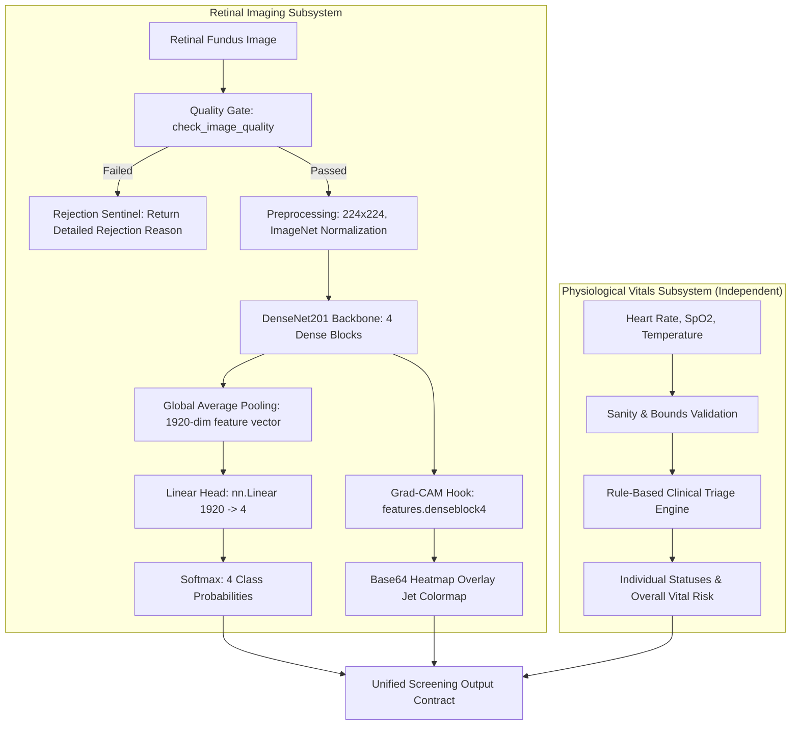

# Model Card: Multimodal Health-Screening ML Module

> **CLINICAL RESEARCH & INVESTIGATIONAL SCREENING NOTICE**  
> This machine learning module is an investigational software prototype designed strictly for clinical screening triage research and decision support.  
> It does **not** constitute a medical device, is **not** cleared by the FDA or CE regulatory bodies, and must **never** be used as an autonomous diagnostic system or as the primary basis for clinical intervention without licensed clinician oversight.

---

## 1. Model Overview

- **Model Identifier:** `multimodal-health-screening-eye-densenet201-v1`
- **Module Version:** `1.0.0`
- **Model Checkpoint:** `eye_model.pth` (Primary production weights)
- **Alternative Checkpoint:** `eye_densenet201_best.pth`
- **Release Date:** October 2026
- **Architecture Type:** Multimodal Screening System (Computer Vision Deep Learning Classifier + Independent Deterministic Physiological Rules Engine)
- **Primary Modalities:**
  1. **Retinal Fundus Photography:** High-resolution digital color fundus images evaluated for ophthalmological abnormalities.
  2. **Physiological Vital Signs:** Resting cardiovascular and systemic measurements (Heart Rate, Blood Oxygen Saturation $\text{SpO}_2$, Body Core Temperature).
- **Core Engineering Principle — Independent Subsystem Execution:**  
  Retinal fundus image classification and physiological vital-sign analysis operate with strict modular independence. A failure, missing measurement, or abnormality in one modality does not corrupt, modulate, or suppress the findings of the other modality.

---

## 2. Intended Use

### 2.1 Primary Intended Use
The multimodal health-screening module is intended for **decision-support and preliminary triage screening** in clinical research environments and primary healthcare workflows. Its goal is to assist medical practitioners in prioritizing high-risk patients for definitive in-person examination by an ophthalmologist or physician.

### 2.2 Target Users
- Qualified ophthalmologists and optometrists seeking automated secondary triage review.
- Trained ophthalmic technicians and nurses operating retinal fundus cameras in rural, mobile, or community screening camps.
- Clinical AI researchers benchmarking multimodal computer vision and physiological screening algorithms.

### 2.3 Intended Deployment Context
- Standalone local Python ML layer running on standard clinical workstations or edge laptops (CUDA GPU or CPU).
- Offline, privacy-preserving processing where patient images and biometric parameters remain within the local facility boundary.

### 2.4 Clinical Decision Support (CDS) Role
The software outputs class probabilities, qualitative risk stratification tiers (`LOW`, `MODERATE`, `HIGH`), and gradient-weighted visual attention maps (Grad-CAM). These artifacts are intended solely to guide clinician attention to suspicious regions (e.g., optic disc cupping, hemorrhages, lens opacities). They are **never** to be presented directly to patients as unadjudicated diagnostic conclusions.

---

## 3. Out-of-Scope Uses

Any operational scenario falling outside the validated bounds listed below is strictly **prohibited and unsupported**:

1. **Autonomous Medical Diagnosis:** Using model outputs as a sole or final medical diagnosis without clinical validation.
2. **Prescription and Surgical Decisions:** Booking cataract extractions, initiating anti-VEGF injections, laser photocoagulation, or prescribing glaucoma medications based on screening predictions.
3. **Pediatric and Neonatal Populations:** The model was trained and evaluated exclusively on adult fundus photography. Pediatric ocular morphologies (e.g., retinopathy of prematurity, retinoblastoma) and pediatric vital sign baselines are unrepresented and will produce unreliable outputs.
4. **Non-Fundus Imaging Modalities:** Inputting anterior segment slit-lamp images, external ocular photography, optical coherence tomography (OCT) volume scans, B-scans, corneal topography, or fluorescein angiography.
5. **Continuous ICU / Telemetry Monitoring:** Vital-sign triage rules are designed for single-point resting adult baselines; they are unsuited for continuous real-time ICU hemodynamic monitoring or stress-test tracking.
6. **Direct-to-Consumer / Unsupervised Self-Testing:** Patient self-diagnosis via web or mobile apps without healthcare provider involvement.
7. **Severity Staging and Progression Grading:** Differentiating between mild non-proliferative diabetic retinopathy (NPDR) vs. proliferative diabetic retinopathy (PDR), or calculating cup-to-disc ratio (CDR) numeric values. The classifier operates strictly on 4 mutually exclusive categorical classes.

---

## 4. Model Architecture

The multimodal health-screening layer comprises two independent subsystems: a deep convolutional neural network for retinal imaging and a deterministic rules engine for vital signs.



### 4.1 Retinal Disease Classifier (DenseNet201)
- **Base Architecture:** DenseNet-201 (`torchvision.models.densenet201`, Huang et al., 2017).
- **Structure:** 201-layer deep network organized into 4 dense blocks (containing 6, 12, 48, and 32 dense layer pairs respectively) connected by transition downsampling layers.
- **Feature Extractor Output:** 1920-dimensional feature vector following global average pooling (`AdaptiveAvgPool2d(output_size=(1, 1))`).
- **Classifier Head:** Single fully connected linear layer:
  $$\text{logits} = W \cdot x + b, \quad W \in \mathbb{R}^{4 \times 1920}, \; b \in \mathbb{R}^4$$
- **Output Activation:** Normalized Softmax across the 4 logits:
  $$P(y = c \mid x) = \frac{\exp(z_c)}{\sum_{j=0}^{3} \exp(z_j)}$$
- **Total Parameters:** Approximately 18.1 million parameters (~70.34 MB uncompressed weights).
- **Canonical Class Ordering (Strictly Preserved):**
  - Index `0`: `cataract`
  - Index `1`: `diabetic_retinopathy`
  - Index `2`: `glaucoma`
  - Index `3`: `normal`

### 4.2 Visual Explainability (Grad-CAM)
- **Target Layer:** `features.denseblock4.denselayer32.conv2` (the terminal convolutional layer of the final dense block).
- **Mathematical Formulation:**
  $$\alpha_k^c = \frac{1}{Z} \sum_{i} \sum_{j} \frac{\partial z_c}{\partial A_{i,j}^k}$$
  $$L_{\text{Grad-CAM}}^c = \text{ReLU}\left(\sum_k \alpha_k^c A^k\right)$$
- **Concurrency & Memory Safety:**
  - Serialized via dedicated module-level lock (`_GRADCAM_LOCK`).
  - Forward and backward hooks are registered dynamically and guaranteed to be deregistered in a `finally` block.
  - Model weights maintain `requires_grad = False` strictly across all layers.
- **Output Rendering:** Normalized heatmap resized to native fundus image dimensions, colorized via OpenCV `cv2.COLORMAP_JET`, and blended with the original RGB image ($\alpha = 0.4$). Exported directly as a Base64-encoded PNG data URI.

### 4.3 Physiological Vital Signs Analysis Engine
- **Methodology:** Deterministic rule-based clinical expert system (NOT a learned neural network or statistical regression model).
- **Plausibility Bounds Guard:**
  - Heart Rate: $[20.0, 300.0]$ BPM
  - Blood Oxygen Saturation ($\text{SpO}_2$): $[0.0, 100.0]$ %
  - Body Core Temperature: $[25.0, 45.0]$ °C
- **Reference Ranges & Threshold Rules (Adult Resting Baseline):**

| Measurement | Unit | Critical Low (Abnormal) | Lower than Usual | Normal Range | Higher than Usual | Critical High (Abnormal) |
|:---|:---:|:---:|:---:|:---:|:---:|:---:|
| **Heart Rate** | BPM | $< 40.0$ | $40.0 \le \text{HR} < 60.0$ | $60.0 \le \text{HR} \le 100.0$ | $100.0 < \text{HR} \le 120.0$ | $> 120.0$ |
| **$\text{SpO}_2$** | % | $< 90.0$ | $90.0 \le \text{SpO}_2 < 95.0$ | $95.0 \le \text{SpO}_2 \le 100.0$ | N/A | N/A |
| **Temperature** | °C | $< 35.0$ | $35.0 \le T < 36.1$ | $36.1 \le T \le 37.2$ | $37.2 < T \le 38.0$ | $> 38.0$ |

- **Aggregated Vital Risk Stratification:**
  - `HIGH`: Any vital sign in the `Abnormal` tier, or conflicting directions (one `Higher than usual` and one `Lower than usual`).
  - `MODERATE`: One or more vital signs `Higher than usual` or `Lower than usual`, but none in `Abnormal`.
  - `LOW`: All three vital signs strictly within `Normal` adult resting reference ranges.

---

## 5. Dataset and Provenance

### 5.1 Dataset Composition & Split Manifest
- **Manifest File:** `ml/dataset/split_manifest.json`
- **Manifest Canonical SHA-256:** `f15d1099d16969ccdde523b2522774ccd9ac97f6561329d444d898240dcf981a`
- **Total Validated Images:** 5,889 retinal fundus images across standard formats (`.jpg`, `.jpeg`, `.png`, `.bmp`).
- **Split Distribution Strategy:** Patient-stratified split (70% train / 15% validation / 15% held-out test).

| Split Name | Image Count | Percentage | Cataract | Diabetic Retinopathy | Glaucoma | Normal |
|:---|:---:|:---:|:---:|:---:|:---:|:---:|
| **Train** | 4,130 | 70.13% | 975 | 1,078 | 958 | 1,119 |
| **Validation** | 865 | 14.69% | 207 | 218 | 198 | 242 |
| **Held-Out Test** | 894 | 15.18% | 210 | 233 | 203 | 248 |
| **Total** | **5,889** | **100.0%** | **1,392** | **1,529** | **1,359** | **1,609** |

### 5.2 Data Provenance & Source Aggregations
Images were consolidated from established public ophthalmological research benchmarks:
1. **RFMiD (Retinal Fundus Multi-Disease Image Dataset):** High-resolution clinical fundus images captured across multiple retinal pathologies.
2. **Kaggle EyePACS / Diabetic Retinopathy Detection Challenge:** Standardized digital color fundus photographs acquired under varied clinical camera specifications.
3. **Kaggle ODIR-5K / OIA (Ocular Disease Intelligent Recognition):** Bitemporal color fundus photographs of both eyes per patient.

### 5.3 Patient Leakage and Data Integrity Audit
To ensure empirical trustworthiness and eliminate data leakage, an exhaustive automated integrity audit was conducted (`ml/data_integrity.py`):
- **Cross-Split Hash Overlap:** **0** identical image content hashes across splits.
- **Cross-Split Patient Overlap:** **0** patients shared between train, validation, and test splits (left and right eyes from any given patient ID were strictly assigned to the same partition).
- **Label Contradictions:** **0** instances of duplicate images having contradictory disease labels.
- **Perceptual Near-Duplicates:** **0** cross-split perceptual near-duplicates detected.
- **Audit Verdict:** The held-out test split is clean, leakage-free, and empirically trustworthy.

### 5.4 Licensing, IRB, and Consent Provenance
- **Dataset Licensing:** Public research benchmark datasets (RFMiD / Kaggle).
- **Institutional Review Board (IRB) Protocols:** `Not documented` in repository.
- **Patient Informed Consent:** `Not documented` in repository.
- **Commercial Usage Rights:** `Not verified`. Users intending commercial deployment must verify third-party license compliance for Kaggle/RFMiD subsets.

---

## 6. Training Procedure

### 6.1 Hardware & Environment Configuration
- **Operating System:** Windows 11 Home / Pro x86_64
- **Python Version:** 3.12.4
- **PyTorch Version:** `2.6.0+cu124` (with CUDA 12.4, cuDNN 90100)
- **Accelerator:** NVIDIA GeForce RTX 4060 Laptop GPU (8GB VRAM)

### 6.2 Optimization & Hyperparameters
- **Optimization Algorithm:** Adam (`torch.optim.Adam`)
- **Initial Learning Rate:** $1 \times 10^{-3}$ (`0.001`)
- **Weight Decay ($L_2$ regularization):** $1 \times 10^{-4}$
- **Batch Size:** 8 (calibrated to fit comfortably within 8GB GPU VRAM while maintaining batch normalization stability)
- **Data Loading Workers:** 0 (configured to prevent Windows `spawn` multiprocessing deadlocks)
- **Learning Rate Scheduler:** `ReduceLROnPlateau` monitoring validation accuracy (`mode='max'`, reduction factor $\gamma = 0.5$, patience $= 3$ epochs).
- **Loss Function:** Weighted Cross-Entropy Loss (`nn.CrossEntropyLoss(weight=weights)`) with inverse class frequencies normalized so the mean weight equals 1.0:
  $$w_c = \frac{N_{\text{total}}}{K \cdot N_c}$$
- **Early Stopping & Model Selection:** Checkpoint saved on epoch with highest validation accuracy. Training planned for 10 epochs; optimal convergence achieved at Epoch 6.
- **Best Validation Accuracy:** **90.29%** (Epoch 6).

### 6.3 Data Augmentation Pipeline (Training Only)
- Resize to $224 \times 224$ (Bilinear interpolation)
- Random Horizontal Flip ($p = 0.5$)
- Random Rotation ($\pm 15^\circ$)
- Color Jitter (Brightness $\pm 20\%$, Contrast $\pm 20\%$)
- Tensor Conversion and Standard ImageNet Normalization ($\mu = [0.485, 0.456, 0.406]$, $\sigma = [0.229, 0.224, 0.225]$)

---

## 7. Evaluation Methodology and Results

### 7.1 Evaluation Cohort
All evaluation metrics were calculated on the **unseen held-out test split** ($N = 894$ images) with no test-time data augmentation and no model fine-tuning.

### 7.2 Core Classification Metrics

| Evaluation Metric | Test Set Value |
|:---|:---:|
| **Overall Accuracy** | **87.81%** (785 / 894 correct) |
| **Macro Precision** | **87.97%** |
| **Macro Recall (Sensitivity)** | **87.74%** |
| **Macro Specificity** | **95.95%** |
| **Macro F1-Score** | **87.78%** |
| **Weighted Precision** | **88.16%** |
| **Weighted Recall** | **87.81%** |
| **Weighted Specificity** | **95.98%** |
| **Weighted F1-Score** | **87.91%** |

### 7.3 Per-Class Performance Breakdown

| Class Index | Pathology Name | Test Support | Precision | Recall (Sensitivity) | Specificity | F1-Score |
|:---:|:---|:---:|:---:|:---:|:---:|:---:|
| `0` | **Cataract** | 210 | 90.00% | 85.71% | 97.08% | 87.80% |
| `1` | **Diabetic Retinopathy** | 233 | 97.27% | 91.85% | 99.09% | 94.48% |
| `2` | **Glaucoma** | 203 | 79.28% | 86.70% | 93.34% | 82.82% |
| `3` | **Normal** | 248 | 85.32% | 86.69% | 94.27% | 86.00% |

### 7.4 Confusion Matrix
Rows represent true ground-truth pathologies; columns represent model predictions:

| True \ Predicted | Cataract (`0`) | Diabetic Retinopathy (`1`) | Glaucoma (`2`) | Normal (`3`) | Total True |
|:---|:---:|:---:|:---:|:---:|:---:|
| **Cataract** | **180** | 2 | 15 | 13 | 210 |
| **Diabetic Retinopathy** | 8 | **214** | 2 | 9 | 233 |
| **Glaucoma** | 8 | 4 | **176** | 15 | 203 |
| **Normal** | 4 | 0 | 29 | **215** | 248 |
| **Total Predicted** | 200 | 220 | 222 | 252 | 894 |

### 7.5 Inference Latency Profile
Measured on single-sample inference ($B=1$, input shape $1 \times 3 \times 224 \times 224$):
- **CUDA (RTX 4060):**
  - Mean Latency: **3.94 ms**
  - Median Latency: **3.05 ms**
  - 95th Percentile ($p_{95}$): **7.65 ms**
  - Min / Max: 3.00 ms / 10.05 ms
- **CPU Fallback:**
  - Mean Latency: **74.41 ms**
  - Median Latency: **73.71 ms**
  - 95th Percentile ($p_{95}$): **78.38 ms**

### 7.6 Calibration & Uncertainty Analysis
- **Expected Calibration Error (ECE, 10 bins):** **0.0269** (2.69%)
- **Maximum Calibration Error (MCE):** **0.2394**
- **Negative Log-Likelihood (NLL):** **0.3352**
- **Brier Score:** **0.1776**
- **Post-Hoc Temperature Scaling:** Optimal temperature fitted on validation set: $T = 1.0618$. Temperature scaling reduced MCE to 0.1373 while maintaining strong calibration across confidence bins.

### 7.7 Robustness & Perturbation Stress Testing
Model stability was systematically assessed across 14 synthetic environmental and acquisition perturbations on all 894 test images:

| Condition / Perturbation | Gate Pass Rate | Overall Accuracy | Macro F1 | Consistency vs Baseline |
|:---|:---:|:---:|:---:|:---:|
| **Baseline Clean Reference** | 43.4% | 87.14% | 87.09% | 100.0% |
| **Brightness Increase (+15%)** | 51.2% | 86.69% | 86.65% | 96.76% |
| **Brightness Decrease (-15%)** | 33.8% | 87.70% | 87.63% | 97.87% |
| **Contrast Increase (+15%)** | 50.1% | 86.91% | 86.86% | 97.09% |
| **Contrast Decrease (-15%)** | 33.9% | 87.36% | 87.28% | 97.99% |
| **Clockwise Rotation (+5°)** | 27.3% | 86.58% | 86.54% | 96.76% |
| **Counter-Clockwise Rotation (-5°)** | 27.1% | 86.69% | 86.62% | 97.43% |
| **Mild Gaussian Blur ($r=1.0$ px)** | 0.0% | 86.13% | 86.14% | 96.53% |
| **JPEG Compression ($Q=50$)** | 31.7% | 85.57% | 85.63% | 95.19% |
| **Additive Gaussian Noise ($\sigma=0.02$)** | 95.5% | 87.25% | 87.23% | 97.20% |
| **Severe Blur ($r=4.0$ px) [Stress Gate]** | **0.0% (Rejected)** | 56.15% | 55.26% | 61.19% |
| **Severe Underexposure (-65%) [Stress Gate]** | **0.9% (Rejected)** | 80.98% | 80.36% | 82.21% |

> [!NOTE]  
> Under extreme degradation (e.g., severe blur), unconstrained neural accuracy falls to 56.15%. However, the automated Quality Gate successfully rejected **100.0%** of these degraded frames, preventing compromised images from reaching inference.

---

## 8. Preprocessing and Quality Requirements

### 8.1 Automated Image Quality Gate (`ml/quality_gate.py`)
To prevent uninterpretable images from polluting clinical screening workflows, all retinal inputs must pass an automated five-point quality inspection:

1. **File Format & Integrity:** Must match supported extensions (`.jpg`, `.jpeg`, `.png`, `.bmp`, `.tif`, `.tiff`, `.webp`), file size $\le 30$ MB, and decode without truncation or non-finite pixel values.
2. **Spatial Resolution:** Width $\ge 224$ px and Height $\ge 224$ px (maximum allowed dimension: $5000 \times 5000$ px).
3. **Sharpness & Focus (Laplacian Variance):**
   $$\text{Var}(\nabla^2 I) \ge 100.0$$
4. **Photometric Illumination (Grayscale Intensity Mean):**
   $$30.0 \le \bar{I} \le 225.0$$
5. **Dynamic Range & Contrast (Grayscale Standard Deviation):**
   $$\sigma_I \ge 20.0$$
6. **Retinal Circular Contour Detection:** OpenCV Hough Gradient circle heuristic must detect a plausible circular fundus perimeter ($r \in [40, 112]$ on a $224 \times 224$ thumbnail).

If any check fails, the quality gate produces an explicit rejection reason (e.g. `"Insufficient contrast (contrast std 14.20 < threshold 20.0)"`), blocking neural inference and prompting image re-acquisition.

### 8.2 Standardized Preprocessing Pipeline (`ml/preprocessing.py`)
- Color Channel Alignment: Converted to 3-channel RGB (handles RGBA transparency stripping and Grayscale channel replication).
- Spatial Resizing: Bilinear interpolation to standardized dimensions ($224 \times 224$).
- Tensor Scaling: Scaled to float32 range $[0.0, 1.0]$.
- Channel Normalization: Standard ImageNet distribution:
  $$\hat{I}_c = \frac{I_c - \mu_c}{\sigma_c}, \quad \mu = [0.485, 0.456, 0.406], \; \sigma = [0.229, 0.224, 0.225]$$
- Dimension Guard: Output tensor shape is strictly $[1, 3, 224, 224]$ with finite numeric verification.

---

## 9. Output Interpretation

### 9.1 Retinal Screening Output Contract

| Field | Type | Description / Interpretation |
|:---|:---:|:---|
| `predicted_class` | `str` | Argmax class: `cataract`, `diabetic_retinopathy`, `glaucoma`, or `normal`. |
| `confidence` | `float` | Softmax probability assigned to the predicted class ($[0.0, 1.0]$). |
| `probabilities` | `dict` | Four-class probability distribution summing to $1.0 \pm 10^{-4}$. |
| `risk_level` | `str` | Triage priority: `LOW` (normal), `MODERATE` (cataract), `HIGH` (diabetic retinopathy or glaucoma). |
| `gradcam` | `str` | Base64-encoded PNG image with red/yellow hot spots denoting salient receptive fields. |

### 9.2 Physiological Vitals Output Contract

| Field | Type | Description / Interpretation |
|:---|:---:|:---|
| `heart_rate.status` | `str` | `Normal`, `Lower than usual`, `Higher than usual`, or `Abnormal`. |
| `spo2.status` | `str` | `Normal`, `Lower than usual`, or `Abnormal`. |
| `temperature.status` | `str` | `Normal`, `Lower than usual`, `Higher than usual`, or `Abnormal`. |
| `overall_status` | `str` | Dominant status across vitals (`Normal`, `Higher than usual`, `Lower than usual`, `Abnormal`). |
| `risk_level` | `str` | Vital-sign triage priority: `LOW`, `MODERATE`, or `HIGH`. |
| `summary` | `str` | Plain-English summary of vital sign findings for clinician reading. |

### 9.3 Unified Multimodal Risk Triage Aggregation
The pipeline aggregates retinal risk and physiological risk via `_aggregate_overall_risk(eye_risk, vitals_risk)`:
- `HIGH`: If **either** retinal screening or vital signs indicate `HIGH` risk.
- `MODERATE`: If neither is `HIGH`, but **at least one** indicates `MODERATE` risk.
- `LOW`: Only when **both** retinal screening and vital signs indicate `LOW` risk.

---

## 10. Limitations and Risks

### 10.1 Dominant Misclassification Modes
Thorough error analysis on the 109 test errors identified four primary failure mechanisms:

1. **The Normal $\leftrightarrow$ Glaucoma Boundary (44 errors, 40.37% of all errors):**
   - **Normal $\to$ Glaucoma (29 cases):** The largest single failure mode. Healthy physiological cup enlargement (large cup-to-disc ratio without rim loss) triggers false positive glaucoma predictions.
   - **Glaucoma $\to$ Normal (15 cases):** Early focal rim notching or subtle glaucomatous neuropathy without massive cup excavation is missed because the macula and surrounding retina appear normal.
2. **Cataract Masking & Illumination Scatter (28 errors, 25.69% of all errors):**
   - **Cataract $\to$ Glaucoma (15 cases):** Dense lens opacities create diffuse light scattering and halo artifacts that blur the optic disc margins, causing the neural network to confuse media haze with optic cup pallor.
   - **Cataract $\to$ Normal (13 cases):** Early anterior or cortical cataract where posterior retinal details remain visible.
3. **Subtle Diabetic Retinopathy Misses (17 errors, 15.60% of all errors):**
   - **DR $\to$ Normal (9 cases):** Downsampling high-resolution fundus images (e.g. $3000 \times 2000$) to $224 \times 224$ destroys small punctate microaneurysms (< 100 $\mu$m in diameter), leading to missed early non-proliferative retinopathy.
   - **DR $\to$ Cataract (8 cases):** Significant media haze masking retinal microvascular exudates.

### 10.2 High-Confidence Failures
In 24 cases (22.02% of all errors), the model produced incorrect predictions with **confidence $\ge 0.80$**; in 10 cases, confidence exceeded **0.90**.  
*Clinical Hazard:* Clinicians must be trained not to treat algorithmic confidence as an indicator of diagnostic truth. Visual inspect of Grad-CAM maps and independent practitioner review are mandatory.

### 10.3 Inherent Limitations of 2D Monocular Fundus Imaging
Color fundus photography lacks stereoscopic depth. Authentic glaucoma diagnosis requires stereoscopic slit-lamp biomicroscopy, optical coherence tomography (OCT) retinal nerve fiber layer (RNFL) thickness maps, and automated perimetric visual field testing.

---

## 11. Ethical and Safety Considerations

### 11.1 Demographic and Geographic Bias
- **Patient Demographics:** Age, sex, self-reported ethnicity, and geographic distributions are **Not documented** in the aggregated benchmark datasets.
- **Fundus Pigmentation Sensitivity:** Retinal pigmentation varies significantly across racial and ethnic groups (e.g., heavily pigmented vs. blonde fundi). The model's cross-ethnic generalization performance is **Not verified**. Deployment in non-validated populations risks elevated false positive or false negative rates.

### 11.2 Privacy and Biometric Protection
- Retinal vascular patterns are unique biometric identifiers.
- The pipeline adheres to privacy best practices by stripping local directory paths from logs, avoiding telemetry leakage of patient file names, and operating entirely on local compute without outbound cloud transmission.

### 11.3 Patient Safety Guardrails
- Automatic rejection of uninterpretable images prevents erroneous clinical inferences.
- Standardized typed exceptions prevent silent processing failures.
- Non-finite pixel trapping prevents NaN propagation through model weights.

---

## 12. Versioning and Checkpoint Provenance

### 12.1 Checkpoint Provenance
- **Primary Weights File:** `ml/weights/eye_model.pth`
- **File Size:** `73,754,057` bytes (~70.34 MB)
- **SHA-256 Digest:** `e819440c35f166c90e6469b071cc83136857e95aa80bcd6697336894bb459f5f`
- **Checkpoint Content:** PyTorch serialization dictionary containing:
  - `state_dict`: Complete weights for DenseNet201 backbone and linear classification head.
  - `epoch`: `6`
  - `best_val_accuracy`: `0.90289` (90.29%)
  - `classes`: `['cataract', 'diabetic_retinopathy', 'glaucoma', 'normal']`
  - `architecture`: `'DenseNet201'`
  - `seed`: `42`
  - `checkpoint_sha256`: `e819440c35f166c90e6469b071cc83136857e95aa80bcd6697336894bb459f5f`

### 12.2 Checkpoint Management & Integrity
Checkpoints are managed via `ml/checkpoint_manager.py` and `ml/weights/checkpoint_selection.json`. Any weights file loaded by the runtime undergoes strict SHA-256 hashing and key architecture validation prior to model instantiation.

---

## 13. Reproducibility Instructions

### 13.1 Environment Setup
```powershell
# 1. Activate project virtual environment
.\venv\Scripts\Activate.ps1

# 2. Verify PyTorch and CUDA availability
python -c "import torch; print(f'PyTorch {torch.__version__}, CUDA: {torch.cuda.is_available()}')"
```

### 13.2 Reproducibility Verification Commands

```powershell
# Run the complete test suite (unit tests, integration tests, contract tests)
python -m pytest ml/tests -v

# Run the dedicated multi-environment numerical consistency audit
python -m ml.verify_reproducibility

# Recompute full held-out test split evaluation metrics
python -m ml.evaluate

# Run comprehensive error analysis and failure mode breakdown
python -m ml.error_analysis

# Execute automated pipeline stress and reliability suite
python -m ml.stress_test

# Run end-to-end multimodal screening demo
python -m ml.demo
```

### 13.3 Numerical Reproducibility Guarantee
Across 40 patient-stratified test samples evaluated between CPU and CUDA:
- Prediction Agreement: **100.0%** (40 / 40 identical predictions)
- Maximum Probability Delta: **0.0002** (due to standard single-precision floating-point rounding between GPU tensor cores and x86 CPU BLAS)
- Mean Probability Delta: **$2.6 \times 10^{-5}$**
- Mean Confidence Delta: **$3.8 \times 10^{-5}$**

---

## 14. Outstanding Verification Requirements

Prior to any prospective clinical trial, regulatory submission, or pilot deployment in a clinical workflow, the following verification milestones must be achieved:

1. **Prospective Multi-Center Clinical Trial:** Clinical utility and sensitivity/specificity must be evaluated prospectively in real-world outpatient clinics against dilated ophthalmoscopy performed by a fellowship-trained retina specialist.
2. **Demographic Subgroup Audit:** Stratified validation measuring sensitivity, specificity, and calibration across diverse patient age cohorts, sexes, and ethnic groups with varied fundus pigmentation.
3. **Multi-Label Pathology Support:** Reformulation of the classification objective to multi-label sigmoid outputs, allowing simultaneous detection of co-occurring conditions (e.g., concurrent Cataract and Diabetic Retinopathy).
4. **Sub-Macular High-Resolution Processing:** Upgrading input resolution (e.g., $448 \times 448$ or dual-stream localized optic disc/fovea crops) to improve detection of subtle microaneurysms in early NPDR.
5. **Regulatory Compliance Certification:** Independent software verification and validation (V&V) under IEC 62304, ISO 14971 medical device risk management, and formal SaMD (Software as a Medical Device) regulatory approval (FDA 510(k) or De Novo / CE MDR mark).
